# For Garden 배경 시안 — 2026-10-25

새 시안 **15장**과 이전 공용 시안 **2장**입니다. 전부 PNG이며 게임에 적용하지 않은 검토용 원화입니다.

## 이번 수정

귀여운 공용 전장 A/B/C는 폐기했습니다. **고대 지층 지하 갱도 전장 A/B/C**로 교체했습니다. 화석 보관 심층갱(TOWER_ENTRY_B / TOWER_LOOP_B)과 같은 공간으로 읽히도록 암층·화석·목재 지지대·작업등을 사용했습니다.

새 파일: `ANCIENT_MINE_FIELD_A.png`(폐광 운반 갱도), `ANCIENT_MINE_FIELD_B.png`(거대 화석 발굴장), `ANCIENT_MINE_FIELD_C.png`(봉인 석문 심층갱). 세 장 모두 **941×1672**입니다.

- 브랜치: `art/background-concepts-20261025`
- 원본: `originals/` · 이전 공용 시안: `previous/`
- 로컬 열람: `index.html`
- 탑 연결 비교: `previews/tower-joins.html`
- 파일별 해상도·SHA-256·Git blob SHA·생성 지시: `manifest.json`
- 해당 파일 커밋 확인: `git log -1 --format="%H %s" -- art-previews/background-concepts-20261025`

## 비율과 해상도

- 지도·탑: **724×2172 (1:3)** — 기존 스테이지 지도 1448×4344와 정확히 같은 비율.
- 전장: **941×1672** — 기존 스테이지/원정 전장 1882×3344와 정확히 같은 비율.
- 원본 해상도의 절반으로 생성한 시안입니다. 모든 17개 파일을 실제 측정했고 새 15개 파일의 Git blob SHA를 업로드 결과와 대조했습니다.

## 지하 탑 사용 범위

A/B/C는 각각 입구와 반복부를 짝으로 고르는 대안입니다. B1–B10에 ENTRY를 한 번, B11–B100에는 같은 LOOP를 10층 단위로 아홉 번 쓰는 구상입니다. 노드·층수·경로 표시는 이미지에 그리지 않았습니다.

**반복 연결은 구도 시안이며 픽셀 단위 무봉제 타일은 아닙니다.** 연결 미리보기를 보고 방향을 선택한 다음 경계 발판·배관·음영을 맞추는 최종 보정이 필요합니다. 실사용 가능하다고 오인하지 않도록 원본을 그대로 이어 비교합니다.

## 시안 목록

### 3·4챕터 공용 지도

| 파일 / 이름 | 해상도 | 원본 |
| --- | --- | --- |
| CH34_MAP_A · 수로와 환승로 | 724×2172 | [PNG](originals/CH34_MAP_A.png) |
| CH34_MAP_B · 뿌리 온실 회랑 | 724×2172 | [PNG](originals/CH34_MAP_B.png) |
| CH34_MAP_C · 심층 철도 관제구 | 724×2172 | [PNG](originals/CH34_MAP_C.png) |

<table><tr>
<td valign="top">CH34_MAP_A <a href="originals/CH34_MAP_A.png">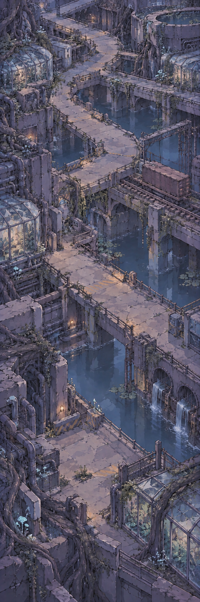</a></td>
<td valign="top">CH34_MAP_B <a href="originals/CH34_MAP_B.png">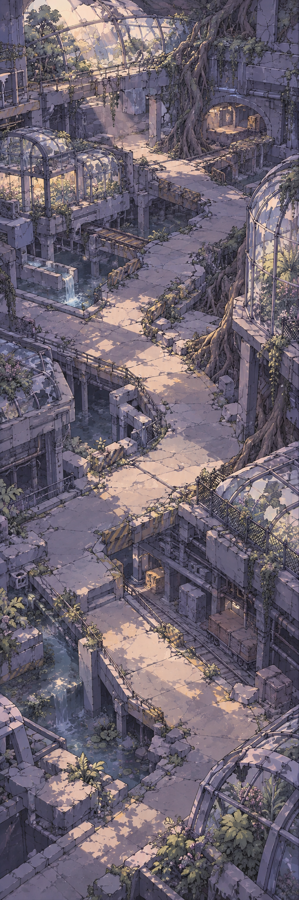</a></td>
<td valign="top">CH34_MAP_C <a href="originals/CH34_MAP_C.png">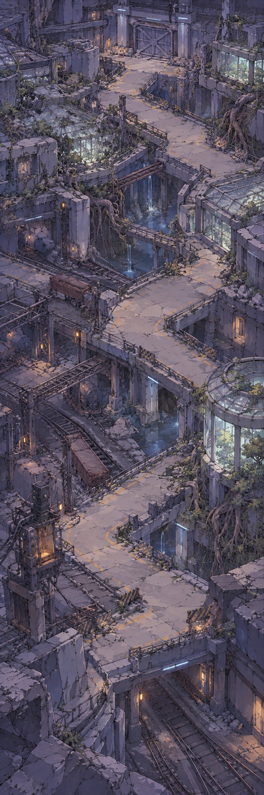</a></td>
</tr></table>

### 3·4챕터 공용 전장

| 파일 / 이름 | 해상도 | 원본 |
| --- | --- | --- |
| CH34_FIELD_A · 수로와 환승로 | 941×1672 | [PNG](originals/CH34_FIELD_A.png) |
| CH34_FIELD_B · 뿌리 온실 회랑 | 941×1672 | [PNG](originals/CH34_FIELD_B.png) |
| CH34_FIELD_C · 심층 철도 관제구 | 941×1672 | [PNG](originals/CH34_FIELD_C.png) |

<table><tr>
<td valign="top">CH34_FIELD_A <a href="originals/CH34_FIELD_A.png">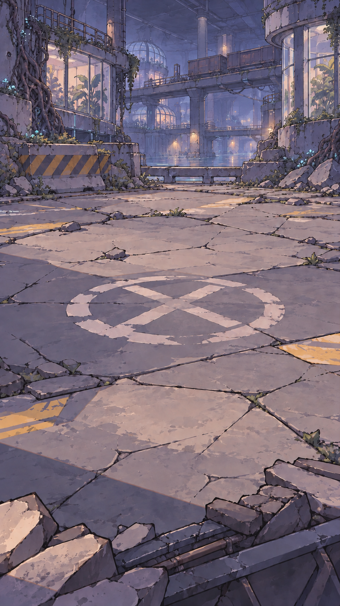</a></td>
<td valign="top">CH34_FIELD_B <a href="originals/CH34_FIELD_B.png">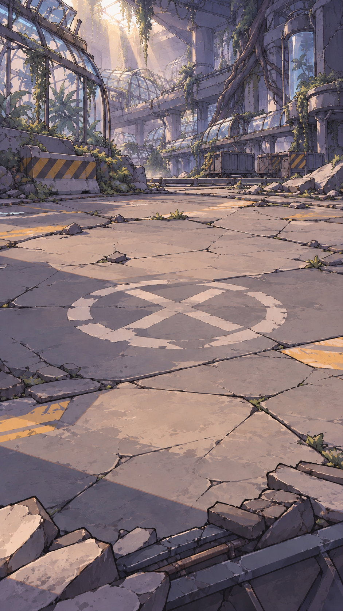</a></td>
<td valign="top">CH34_FIELD_C <a href="originals/CH34_FIELD_C.png">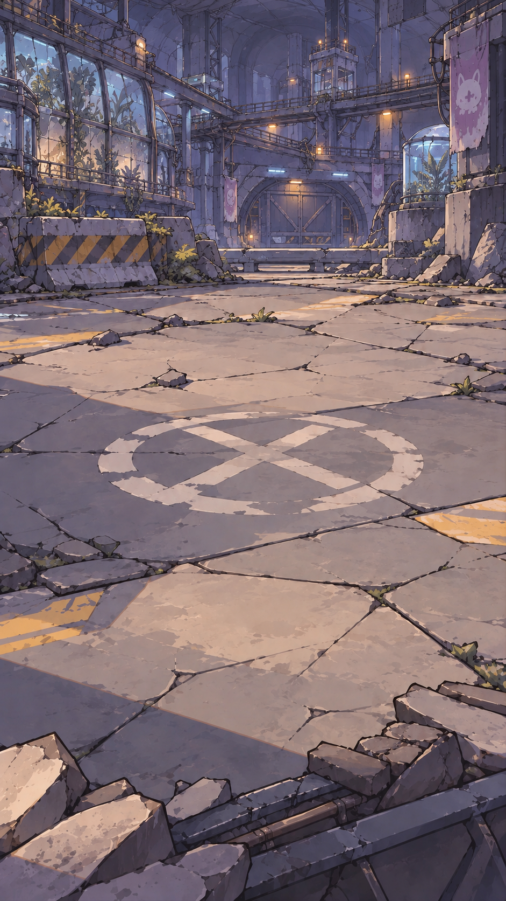</a></td>
</tr></table>

### 지하 탑 B1–B10 진입 구간

| 파일 / 이름 | 해상도 | 원본 |
| --- | --- | --- |
| TOWER_ENTRY_A · 수직 정비 샤프트 | 724×2172 | [PNG](originals/TOWER_ENTRY_A.png) |
| TOWER_ENTRY_B · 화석 보관 심층갱 | 724×2172 | [PNG](originals/TOWER_ENTRY_B.png) |
| TOWER_ENTRY_C · 균사 정원 하강갱 | 724×2172 | [PNG](originals/TOWER_ENTRY_C.png) |

<table><tr>
<td valign="top">TOWER_ENTRY_A <a href="originals/TOWER_ENTRY_A.png">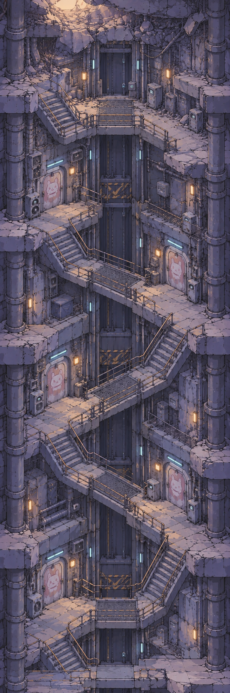</a></td>
<td valign="top">TOWER_ENTRY_B <a href="originals/TOWER_ENTRY_B.png">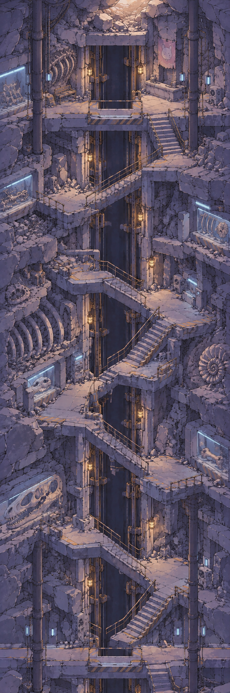</a></td>
<td valign="top">TOWER_ENTRY_C <a href="originals/TOWER_ENTRY_C.png">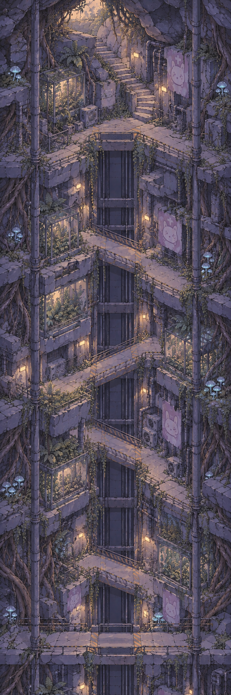</a></td>
</tr></table>

### 지하 탑 B11–B100 반복 구간

| 파일 / 이름 | 해상도 | 원본 |
| --- | --- | --- |
| TOWER_LOOP_A · 수직 정비 샤프트 | 724×2172 | [PNG](originals/TOWER_LOOP_A.png) |
| TOWER_LOOP_B · 화석 보관 심층갱 | 724×2172 | [PNG](originals/TOWER_LOOP_B.png) |
| TOWER_LOOP_C · 균사 정원 하강갱 | 724×2172 | [PNG](originals/TOWER_LOOP_C.png) |

<table><tr>
<td valign="top">TOWER_LOOP_A <a href="originals/TOWER_LOOP_A.png">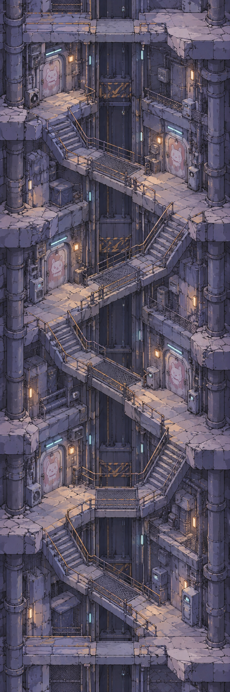</a></td>
<td valign="top">TOWER_LOOP_B <a href="originals/TOWER_LOOP_B.png">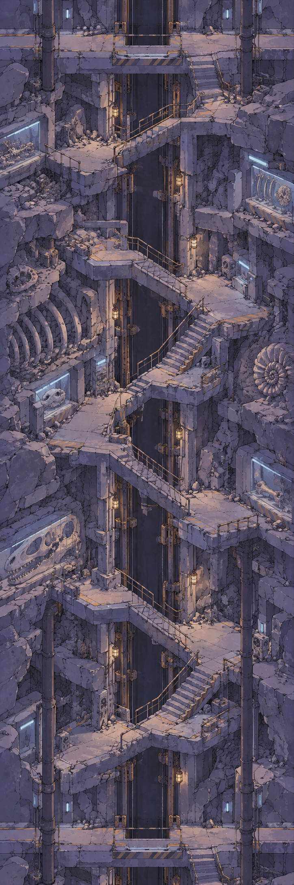</a></td>
<td valign="top">TOWER_LOOP_C <a href="originals/TOWER_LOOP_C.png">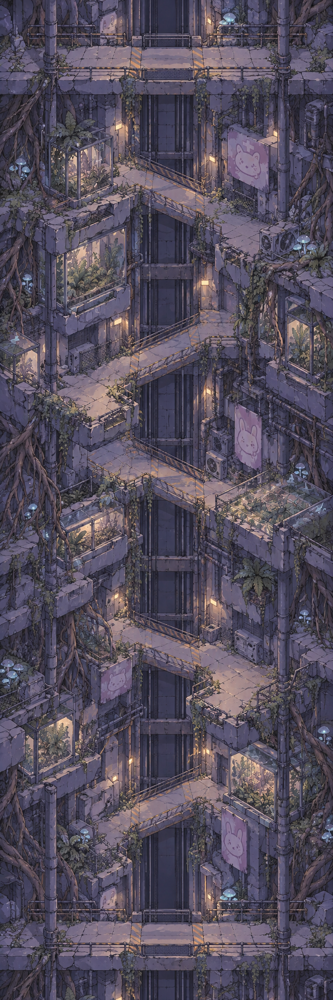</a></td>
</tr></table>

### 고대 지층 지하 갱도 전장

| 파일 / 이름 | 해상도 | 원본 |
| --- | --- | --- |
| ANCIENT_MINE_FIELD_A · 폐광 운반 갱도 | 941×1672 | [PNG](originals/ANCIENT_MINE_FIELD_A.png) |
| ANCIENT_MINE_FIELD_B · 거대 화석 발굴장 | 941×1672 | [PNG](originals/ANCIENT_MINE_FIELD_B.png) |
| ANCIENT_MINE_FIELD_C · 봉인 석문 심층갱 | 941×1672 | [PNG](originals/ANCIENT_MINE_FIELD_C.png) |

<table><tr>
<td valign="top">ANCIENT_MINE_FIELD_A <a href="originals/ANCIENT_MINE_FIELD_A.png">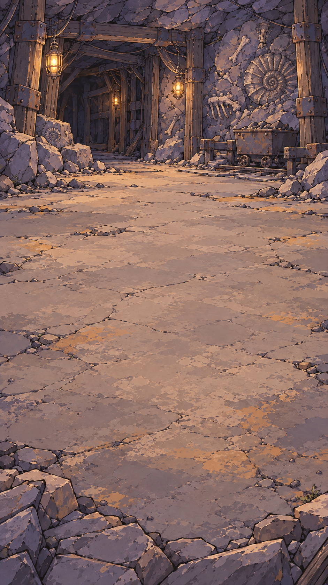</a></td>
<td valign="top">ANCIENT_MINE_FIELD_B <a href="originals/ANCIENT_MINE_FIELD_B.png">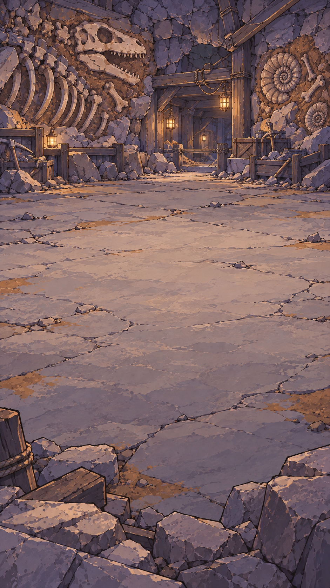</a></td>
<td valign="top">ANCIENT_MINE_FIELD_C </td>
</tr></table>

### 이전 공용 시안

| 파일 / 이름 | 해상도 | 원본 |
| --- | --- | --- |
| CH34_MAP_PREVIOUS · 이전 심층 연구·수송 구역 지도 | 724×2172 | [PNG](previous/CH34_MAP_PREVIOUS.png) |
| CH34_FIELD_PREVIOUS · 이전 심층 연구·수송 구역 전장 | 941×1672 | [PNG](previous/CH34_FIELD_PREVIOUS.png) |

<table><tr>
<td valign="top">CH34_MAP_PREVIOUS <a href="previous/CH34_MAP_PREVIOUS.png">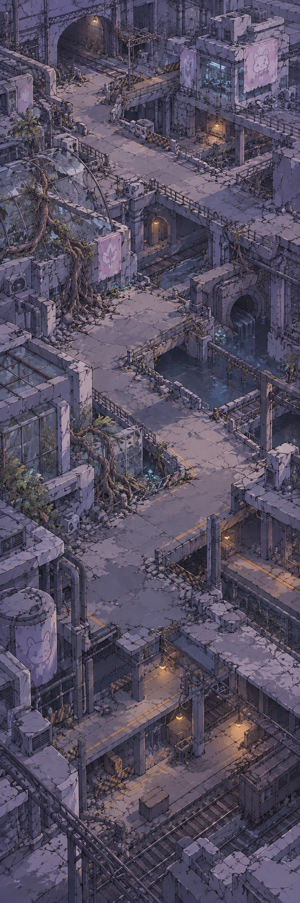</a></td>
<td valign="top">CH34_FIELD_PREVIOUS <a href="previous/CH34_FIELD_PREVIOUS.png">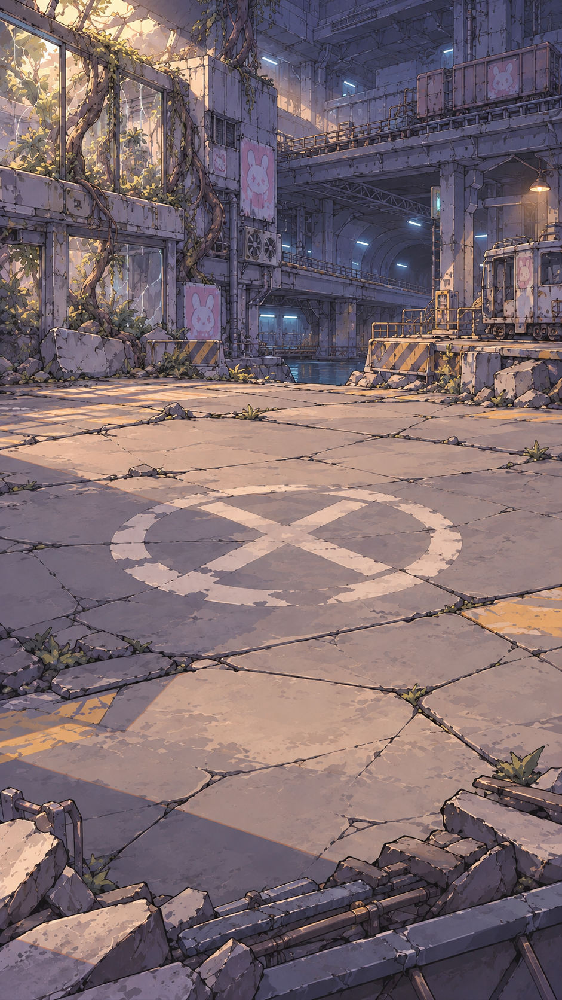</a></td>
</tr></table>

## 클로드 인계

이 브랜치를 fetch한 뒤 위 폴더의 `README.md`와 `manifest.json`을 읽고 원본 PNG를 열면 됩니다. 현재 작업 브랜치를 바꾸지 않고 보려면 별도 worktree를 사용하세요. 게임 코드나 기존 스프라이트는 변경하지 않았습니다.
