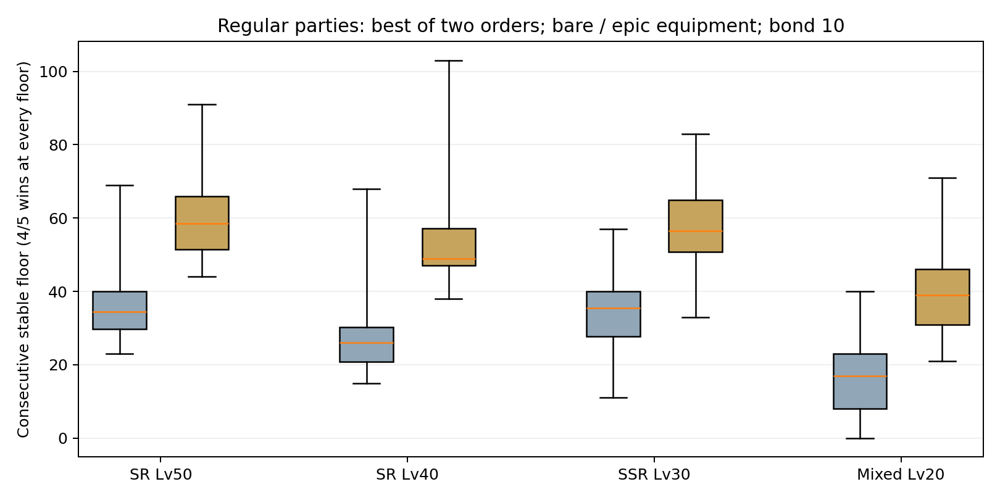

# 고대 지층 성장별 정규 파티 비교 — 2026-10-26

현재 층 편성은 **5종**이다. 코마 단일 정예에 일반 적을 순차 추가하는 형태이며, 무리·일반만 있는 층·2인 정예가 번갈아 나오는 패턴은 아직 없다. 이번 검사는 그 층 구성과 난이도 곡선을 변경하지 않았다.

| 층 | 편성 |
|---|---|
| 1~20 | 정예 코마 1인 |
| 21~40 | 정예 1 + 일반 1(토비) |
| 41~120 | 정예 1 + 일반 2(토비·리파) |
| 121~140 | 정예 1 + 일반 3(+이카닉시아) |
| 141~200 | 정예 1 + 일반 4(+펄시) |

## 조건과 범위

요청한 등급·레벨의 **정규 조합 418종 × 배치 2종 × 장비 2종 = 1,672조건**, 실제 난전 **260,505판**을 검사했다. 캐릭터 원본 목록에서 직접 조합을 생성했으며 탱커 1·전사/암살자 1·지원가 1로 고정했다. 해당 네 그룹의 캐릭터 조합은 전부 검사했지만 6개 배치·모든 룬 빌드·수동 궁극기 전략의 전수 검사는 아니다.

- SR50: 같은 레벨 SR 3인, 돌파 3단계. SR40: SR 3인, 돌파 2단계.
- SSR30: 같은 레벨 SSR 3인, 돌파 1단계. 혼합20: SSR/SR이 각각 한 명 이상인 Lv20 파티, 돌파 0단계.
- 돌파는 해당 레벨 상한을 여는 최소 단계다. 저레벨에서 이미 최대 돌파한 계정의 성능을 뜻하지 않는다.
- 모든 비교의 유대는 10으로 고정했다. 초반 계정의 평균 유대라고 가정하지 않았다.
- 배치는 탱커·딜러·지원 / 딜러·탱커·지원 두 가지. 아래 표는 각 장비 조건에서 두 배치 중 높은 안정 도달층을 표시한다.
- 무장비는 룬 없음. 영웅 룬은 인당 합법적 룬 3개, 옵션별 세공 3회 중 2회 성공, 영웅 특성, 각인 없음이다. 실제 직업별 옵션·특성은 생성기와 원본에 기록했다.
- 자동 궁극기, 30Hz, 매 층 HP/에너지/야성 초기화, 90초 제한, 원정 증강 없음. 시드는 `1729,2531,4099,8191,12289`.
- **안정 도달층:** 앞층부터 매 층 시드 5개 중 4승 이상인 마지막 연속 층. 첫 불안정 층에서 중단한다. 0은 1층에서 이 승률을 못 확보했다는 뜻이며, 1층을 한 번도 못 깼다는 의미는 아니다. 이후의 운 좋은 최고 승리층이나 무제한 재도전의 최대치를 추정하지 않는다.
- 조합별 동일 가중치 통계다. 실제 유저 보유율/장비 분포를 반영한 평균 도달층이나 통계적으로 확정된 모집단 승률이 아니다.

## 전체 분포

| 그룹 | 조합 수 | 무장비 최저/중앙/최고 | 영웅 룬 최저/중앙/최고 |
|---|---:|---:|---:|
| SR 50레벨 | 28 | 23 / 34.5 / 69 | 44 / 58.5 / 91 |
| SR 40레벨 | 28 | 15 / 26 / 68 | 38 / 49 / 103 |
| SSR 30레벨 | 72 | 11 / 35.5 / 57 | 33 / 56.5 / 83 |
| SSR/SR 혼합 20레벨 | 290 | 0 / 17 / 40 | 21 / 39 / 71 |



## 대표 편성 비교

숫자는 무장비 / 영웅 룬의 안정 도달층이다. 표의 파티 이름 순서는 탱커·딜러·지원이며 결과값은 두 검사 배치 중 높은 쪽이다.

| SR 파티 | 40레벨 | 50레벨 |
|---|---:|---:|
| 토리카·루카·스테라 | 32 / 56 | 44 / 62 |
| 토리카·파치·스테라 | 60 / 103 | 63 / 82 |
| 모사나·파치·스테라 | 68 / 89 | 69 / 91 |
| 토리카·파치·테리사 | 40 / 79 | 43 / 75 |
| 모사나·이르나·스테라 | 16 / 41 | 25 / 44 |
| 모사나·델로피·테리사 | 25 / 47 | 29 / 53 |
| 토리카·매디·스테라 | 35 / 64 | 40 / 74 |
| 모사나·케리스·테리사 | 21 / 47 | 31 / 50 |

| SSR 30레벨 파티 | 무장비 | 영웅 룬 |
|---|---:|---:|
| 아크·렉시아·메테 | 57 | 72 |
| 노도니아·스피나·메론 | 20 | 52 |
| 엘라·모르페·슈테 | 40 | 50 |
| 데이·디안·메테 | 40 | 66 |

| SSR/SR 혼합 20레벨 파티 | 무장비 | 영웅 룬 |
|---|---:|---:|
| 토리카·렉시아·메테 | 39 | 53 |
| 아크·루카·스테라 | 14 | 30 |
| 모사나·스피나·테리사 | 8 | 31 |
| 데이·파치·메론 | 22 | 45 |

## 성장 역전 사례와 표의 해석 한계

토리카·파치·스테라의 영웅 룬 안정층은 Lv40/돌파2에서 103, Lv50/돌파3에서 82다. 이 수치만으로 레벨 성장의 전체 성능이 하락했다고 단정하지 않는다. 같은 파티가 낮은 층에서 일부 시드를 놓친 뒤 더 높은 층에서는 다시 이기는 비단조 결과가 있기 때문이다.

합법적인 성장 상태 Lv40/돌파2, Lv40/돌파3, Lv50/돌파3을 두 배치·76/83/99/104층·기존 시드5개+추가 시드5개로 **240판 재검증**했다. 딜러 선두 Lv50/돌파3은 76층에서 기존 3/5·추가 4/5승, 83층에서 1/5·2/5승이었지만, 99층에서는 5/5·4/5승이었다. 낮은 안정층을 절대적인 최대 클리어 층으로 해석하면 잘못된 결론이 된다.

레벨·돌파·궁극기/폭주·이동/표적/제어의 시점이 맞물리는 조합별 검수가 더 필요하다. 이번 표는 연속 안정층과 재도전 최대층을 구분하며, 성장에 따른 모든 시드의 단조 개선이나 CC 안전성을 승인하지 않는다. [성장 조건별 원본](qa/ancient-growth-parties-2026-10-26/growth-check.json)을 보존했다.

## 정정 및 재현

이전 60레벨 자유 편성 표의 디모 직접 편성 3종은 소환 전용 개체를 잘못 허용한 오류였다. 생성기에서 이를 거절하도록 수정하고 기본 프리셋도 실제 플레이 가능한 개체로 교체했다. 과거 원본 45,000판 중 9개 설정/9,000판은 플레이 가능 파티의 근거에서 제외하며, 원본을 새 재실행 결과처럼 덮어쓰지 않았다. 렉시아·토리카·메테와 상위 랭커 정규 파티 결과는 이 오류에 해당하지 않는다. 이번 418개 정규 조합에는 R·적 전용·소환 전용 개체가 없다.

```sh
npm run audit:ancient -- --cohorts --output work/ancient-growth-cohorts.json
npm run audit:ancient -- --growth-check --output work/ancient-growth-check.json
npm run audit:ancient -- --party torika,luka,stella --level 40 --equipment epic --bond 10 --output work/sr40.json
```

전체 두 배치/두 장비 결과: [CSV](qa/ancient-growth-parties-2026-10-26/all-parties.csv). 개별 시드와 최초 불안정 층 원본: [압축 JSON](qa/ancient-growth-parties-2026-10-26/raw-results.json.gz). [조건·요약](qa/ancient-growth-parties-2026-10-26/summary.json). 원본은 압축을 풀어 읽을 수 있다.

층 편성·난이도·보상·서버 진행·기존 CC 경고는 이번 비교에서 변경하지 않았다. 이전에 기록한 CC 경고를 이번 파티 표만으로 해소됐다고 판단하지 않는다.
