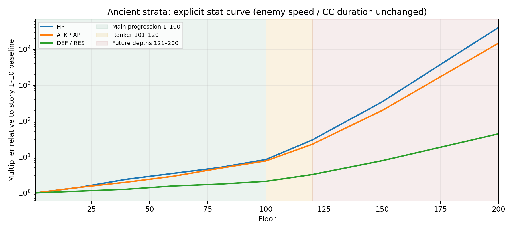
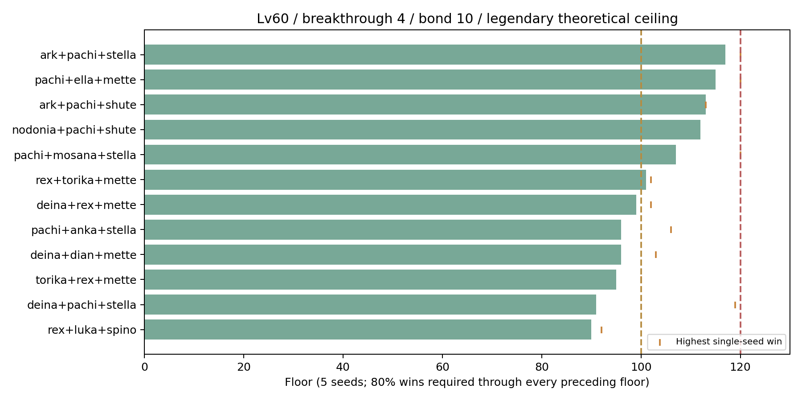

# 고대 지층 1~200층 레벨 디자인 — 2026-10-26

1층은 **쉬움 1-10의 실제 코마 전투**와 동일하게 시작한다. 적 레벨은 기준점인 **Lv20 / 돌파 0**에 고정하고, 고대 지층 전용 체력·공격/주문력·방어/저항 배율을 공개한다. 레벨 60을 넘기는 가짜 성장이나 다른 콘텐츠의 캐릭터 원본 수정은 없다.

이번 구현 범위는 **200층 전투 정의, 지도 적/배율 미리보기, 공용 전투 생성 함수, 재현 가능한 난전·CC 시뮬레이터**다. 현재 QA 지도에는 준비 중 표시가 남아 있으며 서버 입장·층 진행 저장·보상·랭킹 지급은 연결하지 않았다. 클라이언트의 승패만 믿는 임시 보상 API를 추가하지 않았다.

## 전투와 성장 규칙

- 매 층 독립 도전: HP·에너지·야성을 초기화한다. 원정의 누적 체력/증강을 가져오지 않는다.
- 제한 시간 **90초**, 모든 적을 처치해야 승리다. 시뮬레이터는 마지막 틱을 남은 시간에 맞춰 자르고 시간 초과를 승리로 처리하지 않는다.
- 적용 순서는 실제 Lv20 적 성장/유형 → 고대 지층 배율 → 지원 적의 예산 몫이다. 이미 성장한 수치에 레벨 성장을 다시 적용하지 않는다.
- 배율은 주 능력치 다섯 개에만 적용한다. 적의 공속·이속·치명타·흡혈·충전·CC 지속시간·CC 발동 주기는 층 배율로 늘리지 않는다. 캐릭터 고유 폭주는 실전 규칙대로 동작한다.
- 10층 관문 표시는 지도 구간의 끝이다. 숨은 관문 배율이나 11층에서 난이도를 초기화하는 규칙은 없다.
- 기존 적을 약한 적으로 교체하지 않는다. 모든 인접 층에서 기존 적의 체력/공격은 증가하고 나머지 주 능력치는 정수 반올림 후에도 감소하지 않는다. 전용 수치와 추가 적은 `src/data/ancientStrataDifficulty.ts` 한 표가 소유한다.

| 층 | 층당 HP 증가 | 층당 ATK/AP 증가 | 층당 DEF/RES 증가 | 의도 |
|---|---:|---:|---:|---|
| 1~20 | 1.9% | 1.9% | 0.6% | 1-10 기준 진입, 단일 정예 대응 |
| 21~40 | 2.6% | 1.65% | 0.6% | 토비 합류, 유지력·표적 분산 |
| 41~60 | 1.9% | 1.9% | 1.05% | 리파 합류, 3인 적 편성·관통/물리·마법 선택 |
| 61~80 | 1.9% | 2.6% | 0.6% | 생존·보호막·선공 점검 |
| 81~100 | 2.6% | 2.4% | 0.9% | 일반 최종 육성·장비 최적화 구간 |
| 101~120 | 6.5% | 5.5% | 2.2% | 랭커 경쟁, 한 층의 부담을 크게 확대 |
| 121~150 | 8.5% | 7.5% | 3.0% | 미래 구간, 분산 타격·지속 피해 대응 |
| 151~200 | 10% | 9% | 3.5% | 추가 성장 콘텐츠를 위한 설계 예약 |

1층에는 증가율을 곱하지 않는다. 각 구간의 증가율은 직전 층까지 누적한 값에 복리로 이어진다. 첫 100층도 HP·공격·방어를 함께 보면 층당 전투 예산이 약 4.4~6.0% 늘며, 10층 동안의 압박은 누적된다. 단, 압도적인 파티가 초반 적을 한 번에 처치하면 매 층 처치 시간이 늘어나는 것은 아니다.

## 20개 지도 구간의 예산

아래 값은 구간 마지막 층의 **코마 기준 배율**이다. 지원 적은 별도 몫을 곱하며, UI 적 정보에는 그 몫까지 반영된 실제 능력치가 나온다.

| 층 | 마지막 층 HP × | ATK/AP × | DEF/RES × | 최대 편성 |
|---|---:|---:|---:|---|
| 1~10 | 1.18 | 1.18 | 1.06 | 코마 |
| 11~20 | 1.43 | 1.43 | 1.12 | 코마 |
| 21~30 | 1.85 | 1.68 | 1.19 | 코마·토비 |
| 31~40 | 2.39 | 1.98 | 1.26 | 코마·토비 |
| 41~50 | 2.88 | 2.39 | 1.40 | 코마·토비·리파 |
| 51~60 | 3.48 | 2.89 | 1.56 | 코마·토비·리파 |
| 61~70 | 4.20 | 3.74 | 1.65 | 코마·토비·리파 |
| 71~80 | 5.07 | 4.83 | 1.75 | 코마·토비·리파 |
| 81~90 | 6.56 | 6.12 | 1.92 | 코마·토비·리파 |
| 91~100 | 8.48 | 7.76 | 2.10 | 코마·토비·리파 |
| 101~110 | 15.91 | 13.26 | 2.61 | 코마·토비·리파 |
| 111~120 | 29.87 | 22.64 | 3.24 | 코마·토비·리파 |
| 121~130 | 67.52 | 46.67 | 4.36 | 코마·토비·리파·이카닉시아 |
| 131~140 | 152.67 | 96.18 | 5.86 | 코마·토비·리파·이카닉시아 |
| 141~150 | 345.19 | 198.24 | 7.87 | 코마·토비·리파·이카닉시아·펄시 |
| 151~160 | 895.33 | 469.31 | 11.10 | 코마·토비·리파·이카닉시아·펄시 |
| 161~170 | 2322.25 | 1111.02 | 15.66 | 코마·토비·리파·이카닉시아·펄시 |
| 171~180 | 6023.32 | 2630.18 | 22.09 | 코마·토비·리파·이카닉시아·펄시 |
| 181~190 | 15622.95 | 6226.59 | 31.16 | 코마·토비·리파·이카닉시아·펄시 |
| 191~200 | 40521.90 | 14740.60 | 43.95 | 코마·토비·리파·이카닉시아·펄시 |



토비는 21층, 리파는 41층에 합류한다. 각 지원 적은 일반 Lv20 적 예산의 6.75%로 출발해 20층 동안 45%까지 자란다. 121층의 이카닉시아, 141층의 펄시는 45%로 합류한다. 이 둘은 새로운 CC가 아니라 분산 공격·출혈·타격 압박을 만든다. 회수조의 태생 1.3배를 여기에 다시 중복 적용하지 않는다.

초기 설계에서는 큰 적 HP만 올려 뇌진탕 비례 피해와 파치의 보호막이 함께 커졌고, 특정 시드에서 141층 승리가 나왔다. 121층 이후의 분산 타격 편성으로 수정한 최종 표본에서는 120층 초과 승리가 없었다. 파치나 뇌진탕의 전역 스킬 정의를 하향하거나 비율 피해를 숨겨 무효화하지 않았다.

## 파티 시뮬레이션

**정정:** 초기 표의 디모 직접 편성 3종은 소환 전용 개체를 잘못 허용한 무효 표본이다. 아래 과거 표에서 해당 행을 표시했다. 원본 45,000판 중 9개 설정/9,000판을 정규 편성 성능 근거에서 제외한다. 생성기는 소환 전용 개체의 직접 선택을 거절하도록 수정했고, 기본 프리셋은 실제 플레이 가능한 파티로 교체했다. 과거 원본 데이터는 수정해서 재실행 결과처럼 만들지 않고 보존한다. 요청한 레벨·등급의 정규 파티 결과는 [성장별 비교표](ancient-strata-growth-parties.md)를 우선한다.

공용 `createSkirmish`/`stepSkirmish`를 사용한다. 실제 사거리·공속·이속·돌파 효과·룬 옵션/특성·치명타·궁극기·폭주·소환수가 동작한다. 단순 전투력 비례식으로 승패를 정하지 않는다.

기본 표본은 **15개 편성 × 장비 3단계 × 200층 × 시드 5개 = 45,000판**이다. 모든 표본은 Lv60·돌파 4·유대 10이다. 시드는 `1729,2531,4099,8191,12289`, 기본 적분은 30Hz다. 편성 순서도 입력 계약에 포함한다.

- **무장비:** 룬 없음. 캐릭터 고유 성장/돌파/유대만 적용.
- **영웅 룬:** 합법적 룬 3개/인, 주 옵션 2개·보조 옵션 2개, 각 옵션 3회 중 2회 성공, 영웅 특성. 각인 없음.
- **전설 이론 상한:** 룬 3개/인, 주 옵션 2개·보조 옵션 3개, 모든 옵션 3회 성공, 주 옵션 완전 각인, 전설 특성. 옵션 조합과 특성은 원본 JSON에 기록했다. 이는 획득 확률이나 평균 랭커의 장비를 뜻하지 않으며 모든 가능한 전용 특성 조합을 최적화한 결과도 아니다.

**안정 도달층**은 1층부터 매 층 시드 5개 중 4개 이상 승리한 마지막 연속 층이다. **단일 최고 승리층**은 이후 층의 운 좋은 승리도 포함한다. 후자를 실제 진행 가능 층으로 오인하지 않는다. 시드 5개는 회귀용 표본이며 실제 유저 모집단의 승률 추정치는 아니다.

| 파티(앞→뒤 입력 순서) | 무장비 안정층 | 영웅 안정층 | 전설 상한 안정층 | 전설 단일 최고 |
|---|---:|---:|---:|---:|
| 렉시아·토리카·메테 | 83 | 98 | 101 | 102 |
| 토리카·렉시아·메테 | 68 | 82 | 95 | 100 |
| 토리카·루카·메론 | 43 | 61 | 65 | 78 |
| 토리카·렉시아·메론 | 64 | 80 | 81 | 85 |
| **무효: 소환 전용 디모 직접 편성** ·엘라·메테 | 24 | 43 | 54 | 55 |
| **무효: 소환 전용 디모 직접 편성** ·엘라·테리사 | 26 | 39 | 55 | 60 |
| **무효: 소환 전용 디모 직접 편성** ·디안·메론 | 48 | 65 | 67 | 70 |
| 파치·모사나·앙카 | 40 | 80 | 86 | 91 |
| 데이·렉시아·메테 | 70 | 87 | 99 | 102 |
| 토리카·메론·메테 | 40 | 50 | 54 | 64 |
| 렉시아·루카·스피나 | 64 | 87 | 90 | 92 |
| 데이·디안·메테 | 69 | 89 | 96 | 103 |
| 토리카·매디·메테 | 42 | 80 | 83 | 95 |
| 토리카·렉시아·스피나 | 63 | 80 | 85 | 93 |
| 도디·모사나·앙카 | 7 | 39 | 47 | 50 |

## 추가 조합 검색과 랭커 구간

탱커+전사/암살자+지원가 조합의 두 배치 순서를 검색했다. 1,440개 후보를 100층·단일 시드로 선별하고, 통과한 184개 후보를 100/110/120/130/200층에서 시드 5개로 확인해 **6,040판**을 실행했다. 이는 모든 3인 조합/6개 배치/모든 룬 특성의 전수 최적화가 아니다. 선별 시드에서 진 후보는 후속 검사를 받지 않는 한계도 있다.

상위 후보와 기존 위험 후보 7편성은 별도로 1~200층을 전부 검사했다(**7,000판**).

| 전설 상한 파티 | 안정 도달층 | 단일 최고 승리층 |
|---|---:|---:|
| 아크·파치·스테라 | 117 | 120 |
| 파치·엘라·메테 | 115 | 120 |
| 아크·파치·슈테 | 113 | 113 |
| 노도니아·파치·슈테 | 112 | 120 |
| 파치·모사나·스테라 | 107 | 120 |
| 파치·앙카·스테라 | 96 | 106 |
| 데이·파치·스테라 | 91 | 119 |



일반 영웅 룬 표본의 대부분은 100층 미만에서 멈추고, 최적화 편성의 안정 구간은 110층대, 단일 최고 승리는 120층까지였다. 100층 또는 120층에서 전투를 강제 패배시키는 코드/계정별 보정은 없다.

## 입력 정책·시간 해상도·CC 재검사

5개 대표 파티를 90/100/110/120/121/130/200층, 자동/지원기 지연 휴리스틱, 30/60/120Hz, 시드 3개로 비교했다(**630판**). 지원기 지연은 아군 체력이 70% 이하가 될 때 회복/지원 궁극기를 쓰는 근사이며 인간 최적 플레이의 상한이 아니다. 실제 엔진의 자동 궁극기 모드를 전환하므로 적의 궁극기 처리도 해당 실전 모드의 순서를 따른다. 이 비교에서도 121층 이상 승리는 없었다.

전투 틱에 따라 이동·표적·제어 시점과 치명타 난수 소비가 달라 개별 승패가 바뀔 수 있다. 30Hz 결과를 60/120Hz의 동일 판정이라고 포장하지 않았다. 최종 서버 전투 모드 연결 시에는 서버 고정 틱 계약을 함께 확정해야 한다.

**CC 안전 완료로 판정하지 않았다.** 공통 CC 감사기로 15개 시나리오의 양 진영을 검사했고, 기절/경직/넉백뿐 아니라 도발·강제 추격·어그로 왕복도 기존 집계대로 포함했다. 엄격한 일반 스테이지 기준을 넘는 유닛 경고 31건이 남았다. 최대 연속 제어는 파치·엘라·메테/120층에서 리파의 **6.02초**, 해당 제어 점유율은 약 **48.2%**였다. 해당 로그를 `cc-worst.json`에 보존했다. 장기 무한 제어가 없다는 증명으로 해석하지 않는다.

이 경고는 현재 캐릭터 고유 제어의 중첩이며 층당 공속/CC 배율로 늘린 효과가 아니다. 전체 콘텐츠의 스킬을 이번 난이도 조정에 맞춰 몰래 바꾸지 않았다. **플레이 가능한 고대 지층 출시 전에는 이 CC 경고를 별도 조정하고 재검사해야 한다.** 현재의 지도 미리보기와 전투 정의를 CC 안전성까지 승인된 출시 콘텐츠로 취급하지 않는다.

## 재실행

```sh
npm run audit:ancient -- --output work/ancient-full.json
npm run audit:ancient -- --quick --output work/ancient-sample.json
npm run audit:ancient -- --party rex,torika,mette --equipment epic --output work/requested.json
npm run audit:ancient -- --party ark,pachi,stella --equipment ceiling --control manualUltimate --bond 10 --floor 120 --step 0.016666666666666666 --output work/custom.json
npm run audit:ancient -- --search --output work/ancient-search.json
npm run audit:ancient -- --robustness --output work/ancient-robustness.json
npm run audit:cc -- --mode ancient --floor 120 --party pachi,ella,mette --equipment ceiling --targets all --duration 90 --output work/ancient-cc.json
```

`--quick`는 5층 간격·시드 1개만 검사하므로 안정 도달층을 확정하지 않는다. 결과의 `sampledStableThrough`를 정식 연속 도달층으로 사용하지 않는다. 각 JSON 옆 `.runs.csv`에는 개별 시드의 승패·시간·HP·생존자·최초 사망 시각을 기록한다. 소환수를 원래 파티의 생존자 수나 HP 평균 분모에 더하지 않는다.

한국어 QA 브라우저에서 1층/191층의 1인/5인 적 미리보기, 실제 능력치 정보 팝업, 200층 다음 구간 차단을 확인했고 페이지 오류는 0건이었다. 화면 증거는 QA 디렉터리에 보존했다.

정의/회귀/CC 관련 검사는 합산 87개를 통과했다. 병렬 시뮬레이션 중 기존 무거운 스토리 검사가 5초 제한을 한 번 넘겼고, 해당 파일만 다시 실행해 25개 모두 통과했다. 타입 검사·production 빌드·비밀 키/공개 산출물 검사도 통과했다. 변경으로 운영 서버를 배포하거나 보상을 지급하지 않았다.

전체 증거: [QA 디렉터리](qa/ancient-strata-2026-10-26/), [요약 CSV](qa/ancient-strata-2026-10-26/summary.csv), [전체 층/편성 결과](qa/ancient-strata-2026-10-26/full.json), [시간 해상도·CC](qa/ancient-strata-2026-10-26/robustness.json).
