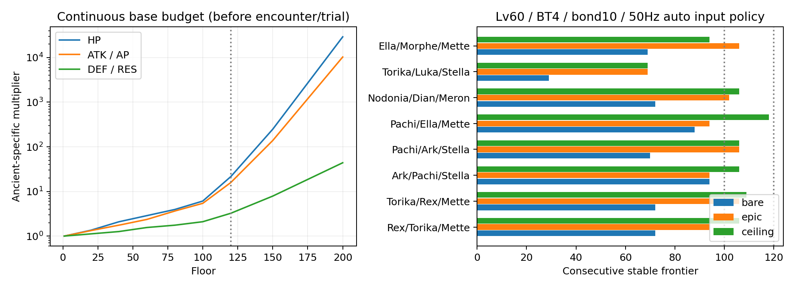
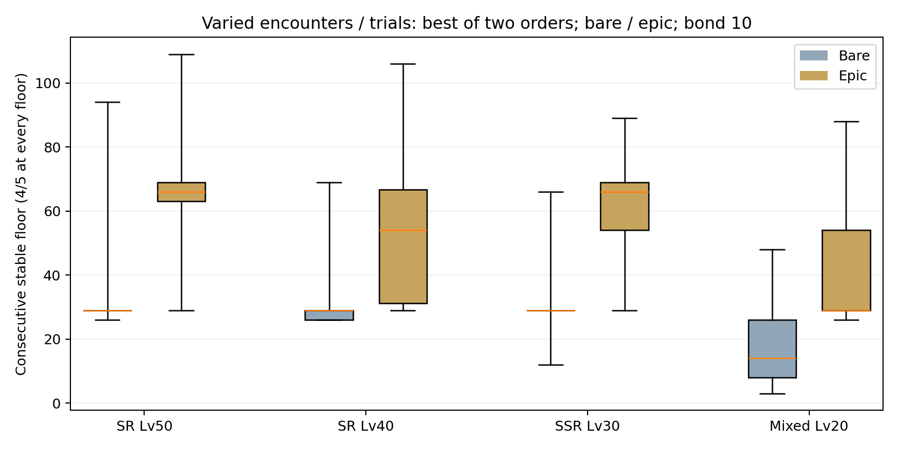

# 고대 지층 재설계 v2 — 매층 조우·시련·젬 100개

> **후속 적 AI 수정 반영:** 아래 도달층·승률 표는 비공격 궁극기 AI 오류를 수정하기 전의 측정 기록이다. 현재 엔진의 재산정 결과로 인용하지 않는다. 능력치 배율·시련·보상은 유지했으며 [AI 수정과 검증](enemy-utility-ai-fix-2026-10-26.md)을 별도로 기록했다.

코마 1인 고정 편성을 폐기했다. **일반·무리·정예·2인 정예·혼합의 5종**, **10개 조우 패턴**, 패턴별 **4개 적 명단**, **6개 시련**을 교차 배치했다. 1~20층은 편성/시련 조합이 모두 다르며, 200층 전체에는 서로 다른 조합 120개가 배치된다. 121층 이후 조합이 돌아와도 전용 능력치 배율은 계속 증가한다.

출격판 → 지도 → 편성 → 전투 → 정산 → 다음 층을 연결했다. 첫 층은 쉬움 1-10 클리어 후, 나머지는 직전 층 클리어 후 열린다. 매 층 최초 승리에 **젬 100개**, 재클리어는 0개다. 100층 누적 10,000개 / 200층 누적 20,000개이며 일일 초기화는 없다. 스테미나는 소모하지 않고, 반복 전투로 유대 경험치·임무를 파밍하지 못하도록 했다.

서버가 전투를 재현해 승리를 확인한 뒤 기존 원자 저장·요청 영수증으로 진행과 보상을 함께 기록한다. 층 건너뛰기, 검증 없는 승리 주장, 동일 요청 재전송, 소비한 전투 증명 재사용을 차단한다. 기존 `clearedStageIds`에 정규형 `ancient:1`~`ancient:200`을 저장하므로 DB 스키마 마이그레이션은 없다.

## 첫 20층

| 층 | 적 편성 | 조우 | 시련 |
|---:|---|---|---|
| 1 | 아모·토비·리파 | 일반 3인 | 지구력: 적 HP +10% |
| 2 | 토비·펄시·리파·토비·리파 | 무리 5인 | 중갑: 적 DEF/RES +20% |
| 3 | 펄시 | 정예 1인 | 맹공: 적 ATK/AP +10% |
| 4 | 아모·이카닉시아·네우리 | 일반 3인 | 속전: 60초 / 적 HP −12% |
| 5 | 토비·펄시 | 2인 정예 | 방벽: 적 시작 보호막 10% |
| 6 | 아트라·토비·리파·펄시·이카닉시아 | 무리 5인 | 선공: 적 시작 궁극기 게이지 20% |
| 7 | 코마·토비·리파 | 정예 1+일반 2 | 지구력: 적 HP +10% |
| 8 | 이카닉시아·펄시·네우리 | 일반 3인 | 중갑: 적 DEF/RES +20% |
| 9 | 미르·이카닉시아 | 2인 정예 | 맹공: 적 ATK/AP +10% |
| 10 | 코마 | 정예 1인 | 속전: 60초 / 적 HP −12% |
| 11 | 아트라·미르·네우리 | 일반 3인 | 선공: 적 시작 궁극기 게이지 20% |
| 12 | 이카닉시아·미르·펄시·네우리·펄시 | 무리 5인 | 지구력: 적 HP +10% |
| 13 | 코마 | 정예 1인 | 중갑: 적 DEF/RES +20% |
| 14 | 아트라·토비·리파 | 일반 3인 | 맹공: 적 ATK/AP +10% |
| 15 | 코마·이카닉시아 | 2인 정예 | 속전: 60초 / 적 HP −12% |
| 16 | 아모·미르·네우리·이카닉시아·펄시 | 무리 5인 | 방벽: 적 시작 보호막 10% |
| 17 | 펄시·아모·네우리 | 정예 1+일반 2 | 선공: 적 시작 궁극기 게이지 20% |
| 18 | 미르·토비·리파 | 일반 3인 | 지구력: 적 HP +10% |
| 19 | 토비·코마 | 2인 정예 | 중갑: 적 DEF/RES +20% |
| 20 | 미르 | 정예 1인 | 맹공: 적 ATK/AP +10% |

시련은 시작 전에 지도에 항상 펼쳐 표시하고, 적 정보에는 실제 적용 능력치를 보여 준다. 새 시련에는 CC·공속·이속 증가를 넣지 않았다. 보호막과 시작 게이지는 적 진영에만 적용하며 기존 캐릭터 스킬은 유지한다. 선공 시련은 첫 궁극기뿐 아니라 그 스킬의 첫 CC 시점도 앞당길 수 있으므로 시련을 적용한 상태로 CC를 검사했다.

## 전용 난이도 예산

적은 Lv20 / 돌파 0에 고정한다. 1층의 기준은 쉬움 1-10 코마의 **총 체력과 평타 압박 예산**이며 코마를 그대로 배치한다는 뜻이 아니다. 편성의 총 HP와 `Σ(max(ATK, AP) × 공속 / 100)`를 해당 층의 예산에 맞춰 나눠, 정예 두 명이라고 체력/공격이 단순히 두 배가 되지 않게 했다. 이 압박식은 스킬·치유·표적 분산을 대신하는 승률 공식이 아니므로 실제 엔진으로 다시 검사했다.

| 구간 | 층당 HP | 층당 ATK/AP | 층당 DEF/RES |
|---|---:|---:|---:|
| 1~20 | +1.6% | +1.5% | +0.6% |
| 21~40 | +2.2% | +1.4% | +0.6% |
| 41~60 | +1.6% | +1.5% | +1.05% |
| 61~80 | +1.6% | +2.2% | +0.6% |
| 81~100 | +2.2% | +2.0% | +0.9% |
| 101~120 | +6.5% | +5.5% | +2.2% |
| 121~150 | +8.5% | +7.5% | +3.0% |
| 151~200 | +10% | +9% | +3.5% |

1층에는 증가율을 곱하지 않고 이후 연속 복리로 적용한다. 앞·다음 층의 기본 예산은 증가하지만 적 유형과 시련이 바뀌므로 모든 파티의 매층 체감 난이도가 단조 증가한다고 보장하지 않는다. 전열 패턴 HP ×0.91, 무리 DEF/RES ×0.9, 나머지 조우 보정 ×1이며 시련 배율은 별도로 적용한다.

대부분 90초, 속전 시련만 60초이며 제한 시각까지 적을 전멸하지 못하면 서버와 클라이언트 모두 패배한다. 매 층 HP·에너지·야성을 초기화하고 원정 증강은 가져오지 않는다. 원본 캐릭터/스토리/레이드의 수치를 바꾸지 않았다.

**121층 이후 심층 규칙:** 추가 HP 배율이 최대 HP 비례 피해를 그대로 증폭하지 않게, 비례 피해의 기준 HP에서 120층 이후의 추가 HP 증가분만 제외한다. 같은 편성/시련의 120층 배율을 기준으로 계산하며 모든 적을 동일한 HP로 취급하는 것은 아니다. 실제 최대 HP는 계속 증가하고 이 규칙도 지도에 공개한다. 비례 피해 빌드가 단독 정예 층을 200층까지 관통하던 초기 시안의 문제를 줄이기 위한 규칙이다.

## 60레벨 재산정

Lv60 / 돌파 4 / 유대 10, 8개 순서 편성 × 장비 3종 × 200층 × 시드 5개 = **24,000판**. 서버와 같은 **50Hz 고정 틱**, 적 코어 AI + 매 틱 뒤 아군 자동 궁극기 입력 정책을 사용했다. 실제 화면은 렌더 프레임 뒤 자동 입력을 처리하므로 저프레임/배속에서는 입력 지연 차이가 생길 수 있다. 결투장용 양 진영 일괄 자동 시전이나 이전 v1의 30Hz 결과를 섞지 않았다.

**연속 안정 도달층**은 1층부터 매 층 5시드 중 4승 이상인 마지막 층이다. 무제한 재도전의 최고층이나 표본으로 확정된 모집단 승률을 뜻하지 않는다. 시드는 `1729,2531,4099,8191,12289`다.

무장비는 룬 없음, 영웅 룬은 인당 3개/세공 3회 중 2회 성공/영웅 특성/각인 없음이다. 상한 장비는 전설 룬·특성, 전 옵션 세공 3회 성공, 완벽 각인으로 구성한 합법적 이론 상한이며 평균 랭커 장비가 아니다. 모든 룬 구성은 공용 생성/강화/각인 규칙을 통과한다.

| 편성 순서 | 무장비 | 영웅 룬 | 상한 장비 |
|---|---:|---:|---:|
| 렉시아·토리카·메테 | 72 | 94 | 106 |
| 토리카·렉시아·메테 | 72 | 106 | 109 |
| 아크·파치·스테라 | 94 | 94 | 106 |
| 파치·아크·스테라 | 70 | 106 | 106 |
| 파치·엘라·메테 | 88 | 94 | 118 |
| 노도니아·디안·메론 | 72 | 102 | 106 |
| 토리카·루카·스테라 | 29 | 69 | 69 |
| 엘라·모르페·메테 | 69 | 106 | 94 |

위 8개 기본 순서 편성 중 매 층 유리한 파티로 바꿔 도전하는 경우의 연속 안정 도달층은 무장비 **94**, 영웅 룬 **106**, 상한 장비 **123**이다. 전체 캐릭터·모든 배치·수동 전략의 최댓값을 증명하지는 않는다.

위 8개 기본 순서 편성의 단일 최고는 118층이지만 파치 계열은 특정 정예 층을 따로 시험하면 **143층 승리**가 남는다. 그 앞의 불안정 층을 무시한 승리를 실제 순차 도달층으로 표기하지 않았다. 다만 재도전·파티 교체로 더 높이 갈 여지가 있으므로 120층을 절대 상한이라고 주장하지 않는다.



### 상위 조합 추가 탐색

플레이 가능한 모든 등급(R 포함)의 탱커 8·전사/암살자 15·지원가 6을 두 배치로 탐색했다. **1,440조건**, 100층 1시드 예선을 통과한 **1,411조건**에 100/110/120/124/130/150/200층을 5시드로 검사해 **50,825판**을 추가했다. 이 값은 체크포인트 승리이며 앞의 모든 층을 돌파했다는 뜻이 아니다. 1시드 예선에서 떨어진 조합의 다른 시드 반등, 6개 전체 배치, 비정규 3인 편성, 모든 룬 빌드는 전수 탐색하지 않았다.

124층 4/5 이상은 네 조건이었다. 이 네 조합을 1~200층 전부 다시 검사했고, 125층까지 연속 안정 돌파한 두 조합은 무장비/영웅 룬도 추가 검사했다. 후속 검사는 **8,000판**이다.

| 상한 장비 편성 순서 | 연속 안정층 | 첫 불안정 층 | 단독 최고 승리층 |
|---|---:|---:|---:|
| 노도니아·파치·스테라 | 125 | 126 | 143 |
| 아크·파치·메테 | 106 | 107 | 143 |
| 모사나·파치·메테 | 118 | 119 | 143 |
| 모사나·파치·스테라 | 125 | 126 | 143 |

| 추가 상위 파티 | 무장비 | 영웅 룬 | 상한 장비 |
|---|---:|---:|---:|
| 노도니아·파치·스테라 | 94 | 118 | 125 |
| 모사나·파치·스테라 | 94 | 94 | 125 |

기본 8조건과 상위 4조건의 상한 장비를 층마다 교체해도 연속 안정 도달층은 **125층**이며 126층은 이 12조건 모두 0/5였다. 이는 모든 합법 파티/재도전의 절대 상한 증명이 아니다. **이론상 상한 장비 최고 125층은 목표 120층보다 5층 높게 관측됐다.** 정확히 120에서 승리를 금지하는 인위적 컷은 두지 않았다.

124층 안정 승리 네 조건은 모두 파치를 포함한다. 비례 피해/고유 스킬에 대한 상위 메타 편중이 남아 있음을 보여 주며, 여러 파티가 같은 최종 층까지 동등하게 올라간다는 의미로 해석하지 않는다. 150·200층은 100층 예선을 통과한 1,411조건 모두 안정 기준을 통과하지 못했다.

[추가 탐색 표](qa/ancient-varied-trials-2026-10-26/level60-search.csv) · [탐색 원본](qa/ancient-varied-trials-2026-10-26/level60-search-raw.json.gz) · [상위 후속 표](qa/ancient-varied-trials-2026-10-26/level60-top-followups.csv) · [후속 개별 시드 원본](qa/ancient-varied-trials-2026-10-26/level60-top-followups-raw.json.gz) · [범위·요약](qa/ancient-varied-trials-2026-10-26/level60-search-summary.json).

```sh
npm run audit:ancient -- --search --output work/ancient-final-search.json
npm run audit:ancient -- --party nodonia,pachi,stella --equipment ceiling --output work/ancient-final-top-nodonia.json
```

## 성장별 정규 파티 재산정

탱커 1·전사/암살자 1·지원가 1의 **418조합 × 배치 2종 × 장비 2종 = 1,672조건**, **264,860판**을 새 편성/시련/곡선으로 재실행했다. 적 전용·소환 전용·R은 제외했다. 네 그룹의 해당 캐릭터 조합은 전부 포함하지만 6개 배치·모든 룬 빌드·수동 궁극기 전략의 전수 검사는 아니다.

- SR50은 돌파 3, SR40은 돌파 2, SSR30은 돌파 1, 혼합20은 돌파 0이다. 레벨 상한을 여는 최소 돌파이며 저레벨 최대 돌파 계정을 가정하지 않았다.
- 혼합20은 SR과 SSR이 각각 한 명 이상인 파티다. 모든 그룹의 유대는 10으로 통제했으므로 초반 계정의 평균 유대로 해석하지 않는다.
- 장비/50Hz/자동 입력/5시드/매층 회복 조건은 위와 같다. 배치는 탱커·딜러·지원 / 딜러·탱커·지원이며 아래 분포는 두 배치 중 더 높은 안정 도달층이다.
- 첫 불안정 층에서 중단했다. 0은 1층의 4/5 기준을 못 확보했다는 뜻이지 1층 승리가 한 번도 없었다는 뜻이 아니다. 최고 행운 승리층이나 이후 반등을 계산한 결과가 아니다.
- 조합별 동일 가중치 분포다. 실제 보유율·장비 분포를 반영한 이용자 평균이나 5시드로 입증한 모집단 승률이 아니다.

| 그룹 | 조합 | 무장비 최저 / 중앙 / 최고 | 영웅 룬 최저 / 중앙 / 최고 |
|---|---:|---:|---:|
| SR 50레벨 | 28 | 26 / 29 / 94 | 29 / 66 / 109 |
| SR 40레벨 | 28 | 26 / 29 / 69 | 29 / 54 / 106 |
| SSR 30레벨 | 72 | 12 / 29 / 66 | 29 / 66 / 89 |
| SSR/SR 혼합 20레벨 | 290 | 3 / 14 / 48 | 26 / 29 / 88 |



### 대표 편성

아래 숫자는 무장비 / 영웅 룬의 연속 안정 도달층이다. 이름 순서는 탱커·딜러·지원이며 두 검사 배치 중 높은 값을 표시했다.

| SR 파티 | 40레벨 | 50레벨 |
|---|---:|---:|
| 토리카·루카·스테라 | 29 / 66 | 29 / 69 |
| 토리카·파치·테리사 | 54 / 94 | 54 / 94 |
| 모사나·이르나·스테라 | 29 / 54 | 29 / 54 |
| 모사나·델로피·테리사 | 26 / 29 | 26 / 29 |
| 토리카·매디·스테라 | 29 / 69 | 48 / 72 |
| 모사나·케리스·테리사 | 29 / 54 | 29 / 54 |

| SSR 30레벨 파티 | 무장비 | 영웅 룬 |
|---|---:|---:|
| 아크·렉시아·메테 | 54 | 69 |
| 노도니아·스피나·메론 | 29 | 29 |
| 엘라·모르페·슈테 | 38 | 70 |
| 데이·디안·메테 | 29 | 72 |

| SSR/SR 혼합 20레벨 파티 | 무장비 | 영웅 룬 |
|---|---:|---:|
| 토리카·렉시아·메테 | 29 | 66 |
| 아크·루카·스테라 | 8 | 29 |
| 모사나·스피나·테리사 | 14 | 29 |
| 데이·파치·메론 | 26 | 66 |

27·30층처럼 적 고유 스킬이 결합되는 구간은 여러 조합의 첫 벽이 된다. SR40/50 무장비 중앙값이 모두 29인 것도 30층 정예 이카닉시아 대응의 영향이며, 같은 중앙값이 레벨 성장이 무의미함을 뜻하지는 않는다. 높은 레벨·장비가 모든 파티/모든 시드에서 단조 우위를 보장한다고 주장하지 않는다.

[418조합 전체 표](qa/ancient-varied-trials-2026-10-26/all-parties.csv) · [1,672 배치/장비 조건](qa/ancient-varied-trials-2026-10-26/all-party-configurations.csv) · [개별 시드와 첫 불안정 층 원본](qa/ancient-varied-trials-2026-10-26/cohorts-raw.json.gz) · [조건·요약·소스 해시](qa/ancient-varied-trials-2026-10-26/cohort-summary.json).
## 렌더·배속에 따른 자동 입력 지연

코어는 50Hz에 고정하고 아군 자동 입력만 20·60·100·200ms 간격으로 묶었다. 상한 장비 3파티 × 경계층 10개 × 입력 간격 4종 × 시드 5개 = **600판**이다. 100ms는 예를 들어 30FPS/3배속의 틱 묶음에 해당한다. 실제 기기 프레임률을 측정한 성능 테스트나 모든 층의 재탐색은 아니다.

30개 파티/층 중 승수가 달라진 것은 2개다. 파치·엘라·메테의 95층은 20ms 입력 5승 → 200ms 입력 4승, 119층은 0승 → 1승이었다. 이번 표본에서는 두 사례 모두 4/5 안정 판정의 통과 여부가 유지됐다. 따라서 입력 시점을 무시한 완전 동일 승패라고 주장하지 않는다. [간격별 표](qa/ancient-varied-trials-2026-10-26/input-cadence.csv)와 [개별 원본](qa/ancient-varied-trials-2026-10-26/cadence-raw.json.gz)을 보존했다.

## CC 과밀 점검 — 진단 경고와 밸런스 판단

**사용자 결정: 데이·토리카·엘라의 현재 CC 수치는 유지한다.** 일반 적 상대의 3탱커 제어 성능을 곧바로 하향 근거로 보지 않고, 정예의 초기20%/누적 최대80% 강인함과 편성의 화력 손해를 함께 판단한다. 아래 진단 경고와 원본 측정값은 보존하며, 적 비공격 궁극기 AI 오류는 캐릭터 밸런스와 별도 문제로 구분한다.

> 후속 [원인 진단](tank-cc-diagnosis-2026-10-26.md): 대표 판의 연속 완전 행동불능은 최대 **5.98초**, **53.12초는 도발 포함 지표**다. 적 비공격 궁극기 AI 공회전도 확인했다. 아래 원본 수치는 수정 전 현행 엔진의 관측 기록이며, AI 수정 후에는 난이도/CC를 재산정해야 한다.

렉시아·토리카·메테 / 파치·엘라·메테 / 데이·토리카·엘라의 Lv60 상한 장비, 12개 층 × 3시드, 양 진영을 실제 생존 조건으로 검사했다. 총 **108조건: 통과 0 / 위험 80 / 관찰 부족 28**. 통과 0은 모든 전투가 무한 CC라는 뜻이 아니다. 적이 빠르게 죽으면 최소 관찰 10초를 채우지 못해 안전으로 승인하지 않는 엄격한 판정이다.

일반 스테이지 기준은 연속 제어 2초 이하, 관찰 구간 제어율 40% 이하, 제어 사이 자유시간 0.5초 이상이다. 기절·경직·빙결·수면·공포·광란·날려버림과 함께 도발 및 도발 후 표적 추적에 낭비한 시간도 CC로 센다. 서로 겹친 시간은 중복 합산하지 않는다.

가장 큰 경고는 **121층 데이·토리카·엘라**다. 일부 적의 연속 제어가 **53.12초**, 관찰 구간 제어율 **87.95%**, 도발 후 강제 추적이 최대 **7.22초**였다. 도발 중에도 공격할 수 있어 연속 제어 전체가 완전 행동불능은 아니지만, 기절이 겹친다. 추가 진단에서 아모의 **70.42초 공격 공백에는 별도 비공격 궁극기 AI 오류가 섞인 것**을 확인했으므로 CC만의 성능으로 인용하지 않는다. 기존 고유 스킬의 조합이며 새 CC 태그나 원정 증강을 추가한 결과가 아니다.

따라서 이번 수치표는 **CC 안전성까지 승인한 출시 판정이 아니다**. 새 시련에 CC를 추가하지 않는 것만으로 기존 도발·충전·기절의 연쇄 문제가 해결되지 않는다. 제한 시간 안의 유한 표본은 수학적 무한 CC의 부재를 증명하지 못한다. 다른 콘텐츠의 고유 스킬을 이 난이도 조정에 끼워서 일괄 하향하지 않았으며, 이 위험을 별도 검토 대상으로 남긴다.

## 재현과 증거

```sh
npm run audit:ancient -- --reprice --output work/ancient-final-reprice.json
npm run audit:ancient -- --cohorts --output work/ancient-final-cohorts.json
npm run audit:ancient -- --cc --output work/ancient-final-cc.json
npm run audit:ancient -- --cadence --output work/ancient-final-cadence.json
```

[전체 200층 정의 CSV](qa/ancient-varied-trials-2026-10-26/floors-1-200.csv) · [60레벨 결과 CSV](qa/ancient-varied-trials-2026-10-26/level60-reference.csv) · [개별 시드 원본](qa/ancient-varied-trials-2026-10-26/reprice-raw.json.gz) · [CC 개체별 표](qa/ancient-varied-trials-2026-10-26/cc-units.csv) · [CC 타임라인 원본](qa/ancient-varied-trials-2026-10-26/cc-raw.json.gz).

화면 증거: [2인 정예/시련/보상](qa/ancient-varied-trials-2026-10-26/floor-5.png), [121층 심층 규칙](qa/ancient-varied-trials-2026-10-26/floor-121.png). 로컬 QA 저장만 사용했고 운영 계정이나 운영 DB를 변경하지 않았다. 배포·원격 푸시는 하지 않았다.

## 기능 검증

- 전체 단위 검사: **403파일 / 4,797통과 / 기존 제외 1개**. 마지막 속전 설명의 HP −12% 표기를 추가한 뒤 언어·용어 검사 22개도 다시 통과했다.
- 프로덕션 클라이언트 빌드, 서버 번들, QA/테스트/프로덕션 서버 어댑터 검사, 빌드별 저장/디버그 격리 검사, 저장소·웹 번들 보안 정적 검사를 통과했다. 정적 검사의 발견 항목은 0개이며 모든 보안 위험의 부재를 증명하는 뜻은 아니다.
- 브라우저는 별도 로컬 QA 문맥/Canvas 렌더러에서 5종 조우, 시련/심층 설명, 순차 해금 표시와 지도 → 편성 → 실제 전투 → 첫 승리 젬100 → 다음 층 편성 진입을 확인했다. 젬 1,000 → 1,100, 오류 0개다. 외부 요청과 `/api/*`를 막아 운영 계정/DB에 쓰지 않았다.
- 서버 입장·전투 증명 재현·보상 중복 차단은 UI의 로컬 FakeServer 성공만으로 대체하지 않고 엄격 서버 핸들러 테스트로 별도 검증했다. 이 기능 검증 통과와 위의 **CC 과밀 위험**은 구분한다.

[브라우저 실행 기록](qa/ancient-varied-trials-2026-10-26/browser.json) · [첫 승리 화면](qa/ancient-varied-trials-2026-10-26/first-clear.png). UI 재검사는 로컬 개발 서버를 별도 터미널에서 켠 뒤 실행한다.

```sh
npm run dev -- --host 127.0.0.1 --port 5180
# 별도 터미널
node scripts/check-ancient-strata-ui.mjs http://127.0.0.1:5180 work/ancient-ui
```
