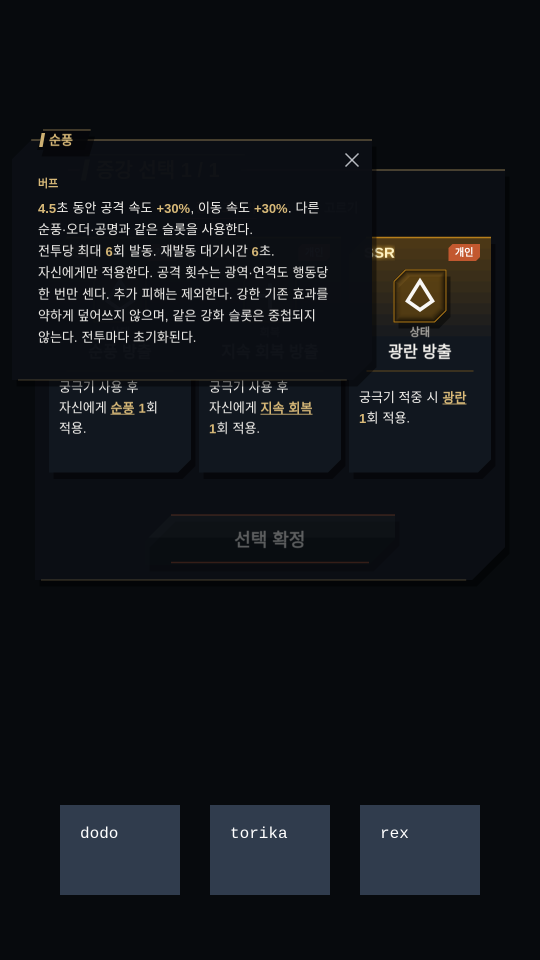

# 원정 증강 전수 조사·확장 검수 — 2026-10-25

기존 중독을 포함한 16계열·34종에서 **30계열·62종**으로 확장했다. 이번에 추가한 계열은 출혈, 기절, 광란, 날려버림, 빙결, 순풍, 오더, 공명, 지속 회복, 은신, 주기 보호막, 야성 추가 획득, 자동 정화, 흉터다.

카탈로그는 기존 31종+태그 증강 62종+능력치 증강 12종=105종이다. 구 출혈 2종, 모호한 상태 위력 2종, 복합 조건 3종을 신규 후보에서 제외하여 활성 후보는 98종이다. 기존 선택 ID는 계속 해석한다. 구 출혈 후보를 더 뽑아 새 비율 피해 상한을 우회하지 않도록 했다.

## 실제 용어 사전 조사 (69개 항목)

전역 `src/data/keywords.ts`의 모든 ID와 전투 상태·강화 계약을 대조했다. 단순 능력치·규칙어·파생 상태를 독립된 새 효과로 중복 집계하지 않았다.

| 용어 | 판정 | 이유·처리 |
|---|---|---|
| 화상 (`burn`) | 보류 | 사전에는 있으나 현 난전 엔진에 공용 화상 상태·틱 경로가 없음 |
| 방어 태세 (`guard`) | 보류 | 사전의 물리 피해 경감과 단순 방어력 증가는 다름. 정확한 시간제 경감 계약이 없어 보류 |
| 야성 (`ferocity`) | 적용 | 현재 범용 증강 또는 해당 증강의 기존 실행 경로 사용 |
| 시약 (`reagent`) | 적용 | 현재 범용 증강 또는 해당 증강의 기존 실행 경로 사용 |
| 시약 반응 (`reagent-reaction`) | 파생·호환 | 시약 최대 겹 소비의 반응으로 제공 |
| 조가비 (`shell`) | 적용 | 현재 범용 증강 또는 해당 증강의 기존 실행 경로 사용 |
| 출혈 (`bleed`) | 적용 | 현재 범용 증강 또는 해당 증강의 기존 실행 경로 사용 |
| 작은 출혈 (`minor-bleed`) | 파생·호환 | 기존 저장은 유지. 신규 후보는 수치·상한이 있는 출혈로 대체 |
| 중독 (`poison`) | 적용 | 현재 범용 증강 또는 해당 증강의 기존 실행 경로 사용 |
| 청산 (`liquidate`) | 규칙·수치 참조 | 독립 상태가 아닌 수치·피해 종류·판정 설명. 기존 수치 증강 또는 태그의 실제 계산에서 사용 |
| 경직 (`stagger`) | 적용 | 현재 범용 증강 또는 해당 증강의 기존 실행 경로 사용 |
| 덧칠 (`overpaint`) | 적용 | 현재 범용 증강 또는 해당 증강의 기존 실행 경로 사용 |
| 듀오 (`duo`) | 보류 | 전투 시작의 듀오 귀속과 후속 스킬을 함께 정의해야 함 |
| 약점 포착 (`weakpoint`) | 보류 | 듀오와 표식 소비 공격 계약 필요 |
| 손질 (`butcher`) | 적용 | 현재 범용 증강 또는 해당 증강의 기존 실행 경로 사용 |
| 밴덜리즘 (`vandalism`) | 적용 | 현재 범용 증강 또는 해당 증강의 기존 실행 경로 사용 |
| 수압 (`pressure`) | 적용 | 현재 범용 증강 또는 해당 증강의 기존 실행 경로 사용 |
| 졸음 (`drowsy`) | 적용 | 현재 범용 증강 또는 해당 증강의 기존 실행 경로 사용 |
| 수면 (`sleep`) | 파생·호환 | 졸음 최대 겹의 수면으로 제공 |
| 위압 (`intimidation`) | 적용 | 현재 범용 증강 또는 해당 증강의 기존 실행 경로 사용 |
| 공포 (`fear`) | 적용 | 현재 범용 증강 또는 해당 증강의 기존 실행 경로 사용 |
| 반향 (`echo`) | 보류 | 반향 제공자의 후속 보호막 패시브 필요 |
| 마디 방벽 (`segment-barrier`) | 보류 | 원본 마디·복구 계약 필요 |
| 겨누기 (`vital-aim`) | 보류 | 원본 표적 겨누기와 겹당 강화 계약 필요 |
| 공명 (`resonance`) | 적용 | 현재 범용 증강 또는 해당 증강의 기존 실행 경로 사용 |
| 행렬 (`worker-march`) | 보류 | 행렬 개체·표적 동기화 계약 필요 |
| 해무 방벽 (`fog-guard`) | 보류 | 원본 해무 영역·보호 계약 필요 |
| 관측 (`observation`) | 보류 | 관측을 발동하는 전용 후속 공격 필요 |
| 저주 (`curse`) | 적용 | 현재 범용 증강 또는 해당 증강의 기존 실행 경로 사용 |
| 광란 (`frenzy`) | 적용 | 현재 범용 증강 또는 해당 증강의 기존 실행 경로 사용 |
| 뇌진탕 (`concussion`) | 적용 | 현재 범용 증강 또는 해당 증강의 기존 실행 경로 사용 |
| 날려버림 (`knockback`) | 적용 | 현재 범용 증강 또는 해당 증강의 기존 실행 경로 사용 |
| 돌진 (`charge`) | 별도 행동 계약 | 위치·사거리·타격 수·애니메이션을 바꾸는 스킬 계약이 필요. 태그 표지만 붙이지 않음 |
| 순풍 (`tailwind`) | 적용 | 현재 범용 증강 또는 해당 증강의 기존 실행 경로 사용 |
| 지속 회복 (`regeneration`) | 적용 | 현재 범용 증강 또는 해당 증강의 기존 실행 경로 사용 |
| 기절 (`stun`) | 적용 | 현재 범용 증강 또는 해당 증강의 기존 실행 경로 사용 |
| 둔화 (`chill`) | 적용 | 현재 범용 증강 또는 해당 증강의 기존 실행 경로 사용 |
| 빙결 (`frozen`) | 적용 | 현재 범용 증강 또는 해당 증강의 기존 실행 경로 사용 |
| 체력 (`hp`) | 규칙·수치 참조 | 독립 상태가 아닌 수치·피해 종류·판정 설명. 기존 수치 증강 또는 태그의 실제 계산에서 사용 |
| 공격력 (`atk`) | 규칙·수치 참조 | 독립 상태가 아닌 수치·피해 종류·판정 설명. 기존 수치 증강 또는 태그의 실제 계산에서 사용 |
| 방어력 (`def`) | 규칙·수치 참조 | 독립 상태가 아닌 수치·피해 종류·판정 설명. 기존 수치 증강 또는 태그의 실제 계산에서 사용 |
| 저항력 (`res`) | 규칙·수치 참조 | 독립 상태가 아닌 수치·피해 종류·판정 설명. 기존 수치 증강 또는 태그의 실제 계산에서 사용 |
| 이동 속도 (`move-speed`) | 규칙·수치 참조 | 독립 상태가 아닌 수치·피해 종류·판정 설명. 기존 수치 증강 또는 태그의 실제 계산에서 사용 |
| 보호막 (`shield`) | 적용 | 현재 범용 증강 또는 해당 증강의 기존 실행 경로 사용 |
| 주문력 (`ap`) | 규칙·수치 참조 | 독립 상태가 아닌 수치·피해 종류·판정 설명. 기존 수치 증강 또는 태그의 실제 계산에서 사용 |
| 기본 공격 (`basic-attack`) | 규칙·수치 참조 | 독립 상태가 아닌 수치·피해 종류·판정 설명. 기존 수치 증강 또는 태그의 실제 계산에서 사용 |
| 공격 속도 (`attack-speed`) | 규칙·수치 참조 | 독립 상태가 아닌 수치·피해 종류·판정 설명. 기존 수치 증강 또는 태그의 실제 계산에서 사용 |
| 은신 (`stealth`) | 적용 | 현재 범용 증강 또는 해당 증강의 기존 실행 경로 사용 |
| 전이 (`transfer`) | 파생·호환 | 원본 전이 경로는 유지. 원종별 사슬·거리 계약 없이 독립 부여하지 않음 |
| 무리 사냥 (`pack-hunt`) | 보류 | 같은 표적을 공격하는 아군 오라와 원본 폭주 계약 필요 |
| 반짝! (`shimmer`) | 보류 | 원본 표식 폭발·후속 공격 계약 필요 |
| 순간이동 (`teleport`) | 별도 행동 계약 | 위치·사거리·타격 수·애니메이션을 바꾸는 스킬 계약이 필요. 태그 표지만 붙이지 않음 |
| 갈래화살 (`split-arrow`) | 별도 행동 계약 | 위치·사거리·타격 수·애니메이션을 바꾸는 스킬 계약이 필요. 태그 표지만 붙이지 않음 |
| 집중 (`focus`) | 보류 | 원본 겹당 공격력·사거리 계약 필요 |
| 여울 (`shallows`) | 보류 | 영역 생성·도약·피해 계약 필요 |
| 강하 (`dive`) | 별도 행동 계약 | 위치·사거리·타격 수·애니메이션을 바꾸는 스킬 계약이 필요. 태그 표지만 붙이지 않음 |
| 연격 (`combo`) | 별도 행동 계약 | 위치·사거리·타격 수·애니메이션을 바꾸는 스킬 계약이 필요. 태그 표지만 붙이지 않음 |
| 잃은 체력 (`missing-hp`) | 규칙·수치 참조 | 독립 상태가 아닌 수치·피해 종류·판정 설명. 기존 수치 증강 또는 태그의 실제 계산에서 사용 |
| 목덜미 (`nape`) | 별도 행동 계약 | 위치·사거리·타격 수·애니메이션을 바꾸는 스킬 계약이 필요. 태그 표지만 붙이지 않음 |
| 물리 피해 (`physical-damage`) | 규칙·수치 참조 | 독립 상태가 아닌 수치·피해 종류·판정 설명. 기존 수치 증강 또는 태그의 실제 계산에서 사용 |
| 마법 피해 (`magical-damage`) | 규칙·수치 참조 | 독립 상태가 아닌 수치·피해 종류·판정 설명. 기존 수치 증강 또는 태그의 실제 계산에서 사용 |
| 도발 (`taunt`) | 적용 | 현재 범용 증강 또는 해당 증강의 기존 실행 경로 사용 |
| 끌어당김 (`pull`) | 별도 행동 계약 | 위치·사거리·타격 수·애니메이션을 바꾸는 스킬 계약이 필요. 태그 표지만 붙이지 않음 |
| 무적 (`invulnerable`) | 보류 | 직접·지속·고정 피해를 전부 차단. 이번 자동 반복 증강에서는 제외 |
| 고정 피해 (`fixed-damage`) | 규칙·수치 참조 | 독립 상태가 아닌 수치·피해 종류·판정 설명. 기존 수치 증강 또는 태그의 실제 계산에서 사용 |
| 군중제어 (`crowd-control`) | 규칙·수치 참조 | 독립 상태가 아닌 수치·피해 종류·판정 설명. 기존 수치 증강 또는 태그의 실제 계산에서 사용 |
| 강인함 (`tenacity`) | 규칙·수치 참조 | 독립 상태가 아닌 수치·피해 종류·판정 설명. 기존 수치 증강 또는 태그의 실제 계산에서 사용 |
| 경감 (`damage-reduction`) | 파생·호환 | 불사 적의 체력 곡선 전용. 일반 방어 태세로 이름만 바꿔 부여하지 않음 |
| 흉터 (`scar`) | 적용 | 현재 범용 증강 또는 해당 증강의 기존 실행 경로 사용 |

문맥 사전에만 있는 **서리깃·오더**도 적용했다. **희열·까칠**은 원본 회복·반격 패시브와 겹 소비 계약을 함께 가져와야 하므로 이번 독립 태그 후보에는 넣지 않았다. **정화**는 기존 `cleanseAllDebuffs`, **야성**은 기존 `gainFerocity` 경로를 사용한다.

## 이번 확장의 실행·밸런스 규칙

- 출혈은 평타 3회마다 2초·초당 대상 기준 체력 0.15%의 고정 피해. 궁극기형은 3초·초당 0.25%, 받는 회복량 15% 감소.
- 출혈·뇌진탕·빙결의 새로운 증강 비율 피해는 대상별 합계 10% 예산을 공유한다. 출혈은 갱신으로 늘어날 수 있는 전체 지속 피해를 보수적으로 미리 예약한다. 불사 보스는 기준 체력·25% 배율·기존 비율 피해 저항을 적용한다.
- 기절은 평타 5회·0.25초 또는 궁극기 적중·0.5초. 광란은 평타 6회·0.4초 또는 궁극기 적중·0.7초. 날려버림은 평타 6회·0.25초 또는 궁극기 적중·0.4초. 모두 횟수·대기시간·공용 강인함으로 제한한다.
- 빙결은 평타 6회·0.35초·해제 피해 0.1%, 궁극기형은 0.6초·0.2%. 8초 대기·전투당 4회이며 이미 빙결 중인 대상을 재빙결해 시간을 늘리지 않는다.
- 순풍·오더·공명은 기존 팀 강화 슬롯 하나를 사용하여 중첩하지 않는다. 원래 스킬의 강한 공격 속도·이동·치명·흡혈·회복 효과를 약한 증강으로 덮어쓰지 않는다. 강화형 궁극기는 **사용 후 자신에게** 적용하여 비공격 회복·지원 궁극기 보유자도 선택할 수 있다.
- 지속 회복은 SR 3초·초당 HP 1.5%, SSR 4초·초당 2%. 중첩하지 않고 회복 틱을 매번 초기화하지 않는다. 강한 기존 재생은 유지하고, 약한 긴 재생의 시간을 강한 새 재생에 합쳐 늘리지 않는다.
- 은신은 직접 피해 6회마다 0.6초 또는 궁극기 사용 후 1초. 8초 대기·전투당 3회. 기존 표적 해제와 단일 대상 은신 규칙을 사용한다.
- 야성 추가 획득은 평타 5회마다 기본 4, 궁극기 사용 후 기본 8. 기존 유대·야성 획득 보정을 적용하고 폭주 중에는 추가로 얻지 않아 폭주를 무한 연장하지 않는다.
- 자동 정화는 직접 피격 5회 또는 궁극기 사용 후. 8초 대기·전투당 3회. 기존 정화 대상만 제거하고 이로운 강화는 유지하며 새 면역을 생성하지 않는다.
- 흉터는 직접 피격 4회마다 1겹 또는 궁극기 사용 후 2겹. 2겹을 소비해 자기 최대 HP 10% 보호막, 소비 후 8초 대기. 아군 보호막을 주는 조가비와 서로 배타적이고, 원래 패시브의 겹과 별도 누적한다.
- 평타·광역·연격은 공격 행동당 한 번만 센다. 피격은 실제 HP 손실을 낸 직접 타격만 센다. 적 태그는 첫 생존 적중 대상 하나, 자기 강화는 자기에게만 적용한다.

## 전체 62종 실데이터와 발동 제한

이 표와 팝업 내용은 실제 카탈로그에서 내보냈다. 설명의 태그는 인게임에서 클릭할 수 있고, 해당 변형의 숫자를 보여 준다.

| 이름·등급 | 설명 | 재발동 | 전투당 상한 |
|---|---|---:|---:|
| 흉터 축적 · SR | 직접 피해를 4회 받을 때마다 흉터 1겹 획득. | 1초 | 8회 |
| 흉터 방출 · SSR | 궁극기 사용 후 자신에게 흉터 2회 적용. | 8초 | 4회 |
| 야성 타격 · SR | 평타 5회 적중마다 자신에게 야성 1회 적용. | 6초 | 5회 |
| 야성 방출 · SSR | 궁극기 사용 후 자신에게 야성 1회 적용. | 6초 | 5회 |
| 정화 반응 · SR | 직접 피해를 5회 받을 때마다 자신에게 정화 1회 적용. | 8초 | 3회 |
| 정화 방출 · SSR | 궁극기 사용 후 자신에게 정화 1회 적용. | 8초 | 3회 |
| 순풍 타격 · SR | 평타 4회 적중마다 자신에게 순풍 1회 적용. | 6초 | 6회 |
| 순풍 방출 · SSR | 궁극기 사용 후 자신에게 순풍 1회 적용. | 6초 | 6회 |
| 오더 타격 · SR | 평타 5회 적중마다 자신에게 오더 1회 적용. | 6초 | 6회 |
| 오더 방출 · SSR | 궁극기 사용 후 자신에게 오더 1회 적용. | 6초 | 6회 |
| 공명 타격 · SR | 평타 4회 적중마다 자신에게 공명 1회 적용. | 6초 | 6회 |
| 공명 방출 · SSR | 궁극기 사용 후 자신에게 공명 1회 적용. | 6초 | 6회 |
| 지속 회복 타격 · SR | 평타 5회 적중마다 자신에게 지속 회복 1회 적용. | 6초 | 6회 |
| 지속 회복 방출 · SSR | 궁극기 사용 후 자신에게 지속 회복 1회 적용. | 6초 | 6회 |
| 은신 반응 · SR | 직접 피해를 6회 받을 때마다 자신에게 은신 1회 적용. | 8초 | 3회 |
| 은신 방출 · SSR | 궁극기 사용 후 자신에게 은신 1회 적용. | 8초 | 3회 |
| 보호막 타격 · SR | 평타 4회 적중마다 자신에게 보호막 1회 적용. | 6초 | 6회 |
| 보호막 방출 · SSR | 궁극기 사용 후 자신에게 보호막 1회 적용. | 6초 | 6회 |
| 빙결 타격 · SR | 평타 6회 적중마다 빙결 1회 적용. | 8초 | 4회 |
| 빙결 방출 · SSR | 궁극기 적중 시 빙결 1회 적용. | 8초 | 4회 |
| 출혈 타격 · SR | 평타 3회 적중마다 출혈 1회 적용. | 3초 | 8회 |
| 출혈 방출 · SSR | 궁극기 적중 시 출혈 1회 적용. | 4초 | 8회 |
| 기절 타격 · SR | 평타 5회 적중마다 기절 1회 적용. | 5초 | 5회 |
| 기절 방출 · SSR | 궁극기 적중 시 기절 1회 적용. | 5초 | 5회 |
| 광란 타격 · SR | 평타 6회 적중마다 광란 1회 적용. | 8초 | 4회 |
| 광란 방출 · SSR | 궁극기 적중 시 광란 1회 적용. | 8초 | 4회 |
| 날려버림 타격 · SR | 평타 6회 적중마다 날려버림 1회 적용. | 8초 | 4회 |
| 날려버림 방출 · SSR | 궁극기 적중 시 날려버림 1회 적용. | 8초 | 4회 |
| 뇌진탕 타격 · SR | 평타 4회 적중마다 뇌진탕 1회 적용. | 3초 | 8회 |
| 뇌진탕 방출 · SSR | 궁극기 적중 시 뇌진탕 1회 적용. | 4초 | 8회 |
| 경직 타격 · SR | 평타 4회 적중마다 경직 1회 적용. | 3초 | 8회 |
| 경직 방출 · SSR | 궁극기 적중 시 경직 1회 적용. | 4초 | 8회 |
| 중독 타격 · SR | 평타 3회 적중마다 중독 1회 적용. | 3초 | 8회 |
| 중독 방출 · SSR | 궁극기 적중 시 중독 1회 적용. | 4초 | 8회 |
| 덧칠 타격 · SR | 평타 4회 적중마다 덧칠 1회 적용. | 3초 | 8회 |
| 덧칠 방출 · SSR | 궁극기 적중 시 덧칠 2회 적용. | 4초 | 8회 |
| 저주 타격 · SR | 평타 3회 적중마다 저주 1회 적용. | 3초 | 8회 |
| 저주 방출 · SSR | 궁극기 적중 시 저주 2회 적용. | 4초 | 8회 |
| 손질 타격 · SR | 평타 3회 적중마다 손질 1회 적용. | 2초 | 12회 |
| 손질 방출 · SSR | 궁극기 적중 시 손질 2회 적용. | 4초 | 12회 |
| 서리깃 타격 · SR | 평타 3회 적중마다 서리깃 1회 적용. | 2초 | 12회 |
| 서리깃 방출 · SSR | 궁극기 적중 시 서리깃 2회 적용. | 4초 | 12회 |
| 밴덜리즘 타격 · SR | 평타 3회 적중마다 밴덜리즘 1회 적용. | 2초 | 12회 |
| 밴덜리즘 방출 · SSR | 궁극기 적중 시 밴덜리즘 2회 적용. | 4초 | 12회 |
| 수압 타격 · SR | 평타 3회 적중마다 수압 1회 적용. | 2초 | 12회 |
| 수압 방출 · SSR | 궁극기 적중 시 수압 2회 적용. | 4초 | 12회 |
| 졸음 타격 · SR | 평타 3회 적중마다 졸음 1회 적용. | 2초 | 12회 |
| 졸음 방출 · SSR | 궁극기 적중 시 졸음 2회 적용. | 4초 | 12회 |
| 위압 타격 · SR | 평타 3회 적중마다 위압 1회 적용. | 2초 | 12회 |
| 위압 방출 · SSR | 궁극기 적중 시 위압 2회 적용. | 4초 | 12회 |
| 둔화 타격 · SR | 평타 4회 적중마다 둔화 1회 적용. | 3초 | 8회 |
| 둔화 방출 · SSR | 궁극기 적중 시 둔화 2회 적용. | 4초 | 8회 |
| 도발 타격 · SR | 평타 4회 적중마다 도발 1회 적용. | 4초 | 6회 |
| 도발 방출 · SSR | 궁극기 적중 시 도발 1회 적용. | 4초 | 6회 |
| 공포 타격 · SR | 평타 4회 적중마다 공포 1회 적용. | 6초 | 5회 |
| 공포 방출 · SSR | 궁극기 적중 시 공포 1회 적용. | 6초 | 5회 |
| 미약한 뇌진탕 · SR | 평타 3회 적중마다 뇌진탕 1회 적용. | 3초 | 10회 |
| 조가비 축적 · SR | 직접 피해를 6회 받을 때마다 조가비 1겹 획득. | 1초 | 9회 |
| 조가비 타격 · SR | 평타 4회 적중마다 조가비 1회 적용. | 2초 | 9회 |
| 조가비 방출 · SSR | 궁극기 적중 시 조가비 2회 적용. | 6초 | 6회 |
| 시약 타격 · SR | 평타 3회 적중마다 시약 1회 적용. | 2초 | 12회 |
| 시약 방출 · SSR | 궁극기 적중 시 시약 2회 적용. | 6초 | 6회 |

## 전투 행렬과 관찰값

실제 전투 엔진으로 공속 60·100·200·400 × 단일·광역·5연격·마법 공격 × 적 1·6명의 32개 조건에서 62종을 각각 측정했다. 총 **1,984개 조건**이다. 기존과 같은 20초 접촉 전투이며, 궁극기는 6·12·18초에 사용한다. 시전자 공격력·주문력 200, 방어력·저항력 300, 체력 2,000, 표적의 비율 피해 기준 체력 10,000을 사용한다. 전투가 끝나지 않게 실제 표적 HP는 1,000,000으로 둔다.

이 행렬의 치명타 난수는 고정이며 원종 폭주는 제거한다. 따라서 오더의 치명타 가치, 야성의 폭주 진입 가치, 해로운 효과가 없는 정화의 가치까지 피해 증가 수치로 평가하지 않는다. 정화·야성·흡혈·재생·비공격 궁극기는 별도 실제 상태 검사로 확인했다.

| 추가 효과의 대표형 | 공속100 물리 피해 증가 | 주된 평가 축 |
|---|---:|---|
| 출혈 타격 | 7.5% | 지속 고정 피해·공통 예산 |
| 출혈 방출 | 21.9% | 지속 고정 피해·회복 감소 |
| 기절 방출 | 0% | 짧은 행동 차단 |
| 광란 방출 | 0.5% | 표적 전환·행동 방해 |
| 날려버림 방출 | 0% | 위치 변경·짧은 행동 차단 |
| 빙결 방출 | 5% | 행동 차단·해제 피해 |
| 순풍 방출 | 0% | 공격 속도·이동 속도·시전 시점 |
| 오더 방출 | 0% | 공격 속도·치명타·흡혈 |
| 공명 방출 | 0% | 공격 속도·시전 시점 |
| 지속 회복 방출 | 0% | 실제 회복량·회복 틱 |
| 은신 방출 | 0% | 표적 해제·짧은 단일 추적 회피 |
| 흉터 방출 | 0% | 자기 보호막·아군 보호와의 선택 |
| 야성 방출 | 0% | 추가 야성·폭주 연장 금지 |
| 정화 반응 | 0% | 해로운 상태 제거·이로운 상태 보존 |

최대 행동 방해 시간은 이 행렬에서 **1.77초/20초**였다. 기절·경직·수면·공포뿐 아니라 빙결·광란·날려버림도 측정했다. 모든 효과의 발동 횟수와 고정 피해 예산이 상한 이내인지 검사했다.

순풍·공명의 궁극기형은 공속100·6초 고정 시전에서는 공격 간격이 빨라져도 추가 평타가 다음 시전의 행동 시간 초기화와 겹쳐 20초 총 피해가 같았다. 실제 로그로 공속이 각각 130·136까지 올라가는 것을 확인했다. 공속200에서는 둘 다 +18.5%로 측정되었다. 이 차이를 숨기거나 임의의 공격력 환산 점수로 채우지 않았다. 캐릭터의 기본 공속과 궁극기 시점에 따라 다른 빌드가 유리할 수 있다.

세부 측정값은 [balance.csv](qa/expedition-augments-2026-10-25/balance.csv), 변형별 실제 효과와 팝업 문장은 [catalogue.json](qa/expedition-augments-2026-10-25/catalogue.json)에 있다. 모든 로스터·레벨·원정 승률의 동등성을 보증하는 수치는 아니다.

## UI·검증

- 후보·확정 목록에서 태그를 누르면 실제 증강 변형의 수치와 제한을 표시한다. 피격 은신·정화를 잘못 ‘1겹 획득’으로 표시하지 않고 ‘자신에게 1회 적용’으로 표시한다.
- 순풍·오더·공명·지속 회복·은신은 실제 전투 상태 목록에도 나타난다. 흉터와 조가비는 이름과 겹을 구분한다.
- 지원 언어 12개와 번역 원고를 함께 갱신했다.
- 브라우저에서 순풍 30%·4.5초, 지속 회복 초당 2%·4초, 광란 0.7초를 확인했다. 태그 클릭 후 카드 선택 상태는 비어 있었고 브라우저 스크립트 오류는 0건이었다.
- 집중 검증 339개 통과. 전체 회귀와 최종 빌드 결과는 아래 최종 확인란에 기록한다.

최종 확인: 최신 main 통합 회귀 936개 및 추가 재검사 27개 통과, 프로덕션 빌드 통과. 3인 혼합 CC 과밀도 점검은 별도 도구로 진행 중이며, 위 단일 증강 행렬만으로 혼합 빌드의 안전성을 보증하지 않는다.

## 추가 능력치 증강

흡혈 +4/+7%p, 치명타 확률 +8/+14%p, 치명타 피해 +25/+45%p, 평타당 에너지 +2/+4, 야성 획득량 +12/+20%, 이동 속도 +12/+20%를 SR/SSR로 추가했다. 기존 고유 능력치에 합산하며 에너지는 백분율이 아닌 실제 획득량이다. 실제 피해 흡혈·보호막·초과 피해·에너지·치명타·이동을 회귀 검사했다.

최신 획득 규칙: 겹치지 않는 개인 증강은 렐릭마다 한 번 획득하며, 셋 모두 가진 뒤 후보에서 제외한다. 같은 태그의 다른 변형은 런 전체에서 배타적이다. 따라서 동일 증강을 세 명에게 분산한 CC 조합도 별도 점검 대상이다.
