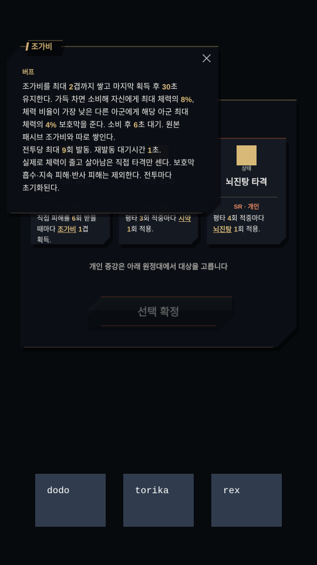

# 원정 태그 증강 구현·밸런스 검수

후속 확장: [2026-10-25 전수 조사·62종 검수](expedition-tag-audit-2026-10-25.md). 아래 내용은 최초 34종 구현 당시의 기록이다.

2026-10-24 · For-Garden

## 반영한 범위

기존 태그 16계열을 이용한 증강 34종을 추가했다. 새 증강은 평타 N회 적중, 궁극기 적중, 직접 피격 N회로 발동한다. 평타 연계의 마지막 타격, 적의 특정 행동 중 적중, 치명타 같은 추가 조작 조건은 쓰지 않는다.

전체 카탈로그는 기존 31종과 신규 34종으로 65종이다. 그중 모호한 상태 위력 2종과 복합 조건 3종을 신규 후보에서 제외하여 활성 후보는 60종이다. 기존 저장의 ID와 효과는 계속 해석한다. 개인 태그 증강은 렐릭마다 한 번만 획득할 수 있으며, 같은 태그의 평타형·궁극기형·미약형은 한 런에서 서로 배타적이다.

궁극기 **적중형**은 피해를 주는 궁극기를 가진 캐릭터만 선택할 수 있다. 비공격 회복·지원 궁극기 보유자에게 효과 없는 후보를 배정하지 않도록 후보 생성과 확정 검증에서 모두 검사한다.

## 공통 규칙

- 광역·연격은 공격 행동당 한 번만 센다. 첫 생존 적중 대상 한 명에게 적용하고, 대상 변경으로 카운터를 초기화하지 않는다. 추가 피해는 카운터를 올리지 않는다.
- 피격형은 실제 HP 손실을 일으키고 살아남은 직접 타격만 센다. 보호막 흡수·지속 피해·반사 피해를 제외한다.
- 모든 발동형 효과에 전투당 횟수와 재발동 대기시간을 둔다. 대기시간 중 N회 문턱을 넘긴 발동은 보관하지 않는다.
- 강한 동일 태그가 적용 중이면 약한 증강으로 효과 수치나 지속시간을 낮추지 않는다.
- 조가비·시약 증강은 원본 패시브와 별도 장부를 사용한다. 원래 해당 패시브가 없는 캐릭터에게도 소비·반응이 작동한다.
- 새 뇌진탕은 대상별로 모든 제공자의 합계가 최대 체력 10%를 넘지 않는다. 불사 보스에서는 무한 HP 대신 전투가 제공한 기준 체력과 25% 배율을 쓰고, 기존 보스 비율 피해 저항도 적용한다.
- 제어 효과는 기존 강인함·면역·제어 저항 경계를 통과한다. 전투가 바뀌면 카운터·발동 장부·겹이 초기화된다.

## 태그별 실제 수치

- **뇌진탕:** 평타 4회마다 최대 체력 0.5% 고정 피해. 궁극기형은 0.8%. 치명타 배증 없음.
- **경직:** 평타 4회마다 0.15초 경직. 궁극기형은 0.3초. 공용 강인함 적용.
- **중독:** 평타 3회마다 3초 중독, 초당 공격력 8%+주문력 8%의 마법 피해. 궁극기형은 4초·각 16%.
- **덧칠:** 평타 4회마다 1겹, 겹당 받는 피해 +3%, 최대 3겹·8초. 궁극기형은 2회 적용.
- **저주:** 평타 3회마다 1겹, 겹당 저항 -4%, 최대 3겹·6초. 궁극기형은 겹당 -6%·10초·2회 적용.
- **손질:** 평타 3회마다 1겹. 3겹 소비 시 공격력 180% 물리 피해. 궁극기형은 2회 적용.
- **서리깃:** 평타 3회마다 1겹, 12초 안에 3겹이면 소비. 3초에 걸쳐 공격력 총 60% 피해, 2초 동안 공격·이동 속도 -10%. 궁극기형은 2회 적용·총 위력 90%.
- **밴덜리즘:** 평타 3회마다 1겹, 겹당 공격력·주문력 -2%. 4겹 소비 시 주문력 180% 마법 피해. 궁극기형은 2회 적용·겹당 -3%·위력 270%.
- **수압:** 평타 3회마다 1겹, 겹당 공격·이동 속도 -3%. 12초 안에 3겹이면 소비해 0.4초 기절·방어력 55%+저항력 55% 물리 피해. 기절 후 6초 잠금. 궁극기형은 2회 적용·0.6초·각 80%.
- **졸음:** 평타 3회마다 1겹, 12초 안에 3겹이면 0.6초 수면. 피해로 깨면 저항력 45% 마법 피해와 2초간 공격 속도 -8%. 궁극기형은 2회 적용·수면 1.8초·위력 70%·감속 12%.
- **위압:** 평타 3회마다 1겹, 12초 안에 3겹이면 0.6초 공포. 이후 6초 면역. 궁극기형은 2회 적용·공포 0.9초.
- **둔화:** 평타 4회마다 1겹, 겹당 공격·이동 속도 -3%, 최대 3겹. 자체 빙결 없음. 궁극기형은 2회 적용.
- **도발:** 평타 4회마다 0.8초 도발. 궁극기형은 1.2초. 공용 강인함 적용.
- **공포:** 평타 4회마다 0.4초 공포, 이후 6초 면역. 궁극기형은 0.6초.
- **조가비:** 피격형: 직접 피해 6회마다 1겹, 2겹에 소비. 평타형: 평타 4회마다 1겹, 3겹에 소비. 궁극기형: 2겹 획득, 3겹에 소비. 겹 유지 30초, 소비 후 6초 대기. 자신 최대 HP 8%와 체력 비율 최저인 다른 아군 최대 HP 4% 보호막.
- **시약:** 평타 3회마다 1겹 또는 궁극기 적중 시 2겹. 16초 안에 3겹이면 소비해 공용 중독 3초, 저항 -8% 4초, 체력 비율 최저 아군 최대 HP 3% 회복. 공용 중독은 초당 공격력 22%+주문력 22%의 마법 피해.

미약한 뇌진탕은 별도 SR 변형으로, 평타 3회마다 최대 체력 0.3% 고정 피해를 준다.

## 34종 발동 제한과 20초 실측

아래 피해 증가는 같은 조건의 무증강 전투 대비 총 피해 차이다. 방어·제어·회복·파티 지원 가치는 피해 증가 수치에 합산하지 않았다. 제어 시간은 기절·경직·수면·공포가 실제 유지된 시간이며 둔화·도발은 포함하지 않는다. 따라서 피해 증가 0%는 무효 효과를 뜻하지 않는다.

| 증강 | 발동 조건 | 재발동 / 전투 상한 | 20초 발동 | 물리 피해 증가 | 마법 피해 증가 | 제어 시간 |
|---|---|---|---:|---:|---:|---:|
| 뇌진탕 타격 | 평타 4회 | 3초 / 8회 | 3 | 18.8% | 18.8% | 0.00초 |
| 뇌진탕 방출 | 궁극기 적중 | 4초 / 8회 | 3 | 30% | 30% | 0.00초 |
| 경직 타격 | 평타 4회 | 3초 / 8회 | 3 | 0% | 0% | 0.50초 |
| 경직 방출 | 궁극기 적중 | 4초 / 8회 | 3 | 0% | 0% | 0.90초 |
| 중독 타격 | 평타 3회 | 3초 / 8회 | 4 | 11% | 11% | 0.00초 |
| 중독 방출 | 궁극기 적중 | 4초 / 8회 | 3 | 18% | 18% | 0.00초 |
| 덧칠 타격 | 평타 4회 | 3초 / 8회 | 3 | 4.4% | 4.4% | 0.00초 |
| 덧칠 방출 | 궁극기 적중 | 4초 / 8회 | 3 | 5.6% | 5.6% | 0.00초 |
| 저주 타격 | 평타 3회 | 3초 / 8회 | 4 | 0% | 5.6% | 0.00초 |
| 저주 방출 | 궁극기 적중 | 4초 / 8회 | 3 | 0% | 9.1% | 0.00초 |
| 손질 타격 | 평타 3회 | 2초 / 12회 | 4 | 11.3% | 11.3% | 0.00초 |
| 손질 방출 | 궁극기 적중 | 4초 / 12회 | 3 | 22.5% | 22.5% | 0.00초 |
| 서리깃 타격 | 평타 3회 | 2초 / 12회 | 4 | 15% | 15% | 0.00초 |
| 서리깃 방출 | 궁극기 적중 | 4초 / 12회 | 3 | 30% | 30% | 0.00초 |
| 밴덜리즘 타격 | 평타 3회 | 2초 / 12회 | 4 | 11.3% | 11.3% | 0.00초 |
| 밴덜리즘 방출 | 궁극기 적중 | 4초 / 12회 | 3 | 16.9% | 16.9% | 0.00초 |
| 수압 타격 | 평타 3회 | 2초 / 12회 | 4 | 10.4% | 10.4% | 0.43초 |
| 수압 방출 | 궁극기 적중 | 4초 / 12회 | 3 | 15% | 15% | 0.60초 |
| 졸음 타격 | 평타 3회 | 2초 / 12회 | 4 | 0% | 0% | 0.57초 |
| 졸음 방출 | 궁극기 적중 | 4초 / 12회 | 3 | 6.6% | 6.6% | 1.47초 |
| 위압 타격 | 평타 3회 | 2초 / 12회 | 4 | 0% | 0% | 0.57초 |
| 위압 방출 | 궁극기 적중 | 4초 / 12회 | 3 | 0% | 0% | 0.87초 |
| 둔화 타격 | 평타 4회 | 3초 / 8회 | 3 | 0% | 0% | 0.00초 |
| 둔화 방출 | 궁극기 적중 | 4초 / 8회 | 3 | 0% | 0% | 0.00초 |
| 도발 타격 | 평타 4회 | 4초 / 6회 | 3 | 0% | 0% | 0.00초 |
| 도발 방출 | 궁극기 적중 | 4초 / 6회 | 3 | 0% | 0% | 0.00초 |
| 공포 타격 | 평타 4회 | 6초 / 5회 | 3 | 0% | 0% | 0.73초 |
| 공포 방출 | 궁극기 적중 | 6초 / 5회 | 3 | 0% | 0% | 1.13초 |
| 뇌진탕 미약형 | 평타 3회 | 3초 / 10회 | 4 | 15% | 15% | 0.00초 |
| 조가비 축적 | 직접 피격 6회 | 1초 / 9회 | 2 | 0% | 0% | 0.00초 |
| 조가비 타격 | 평타 4회 | 2초 / 9회 | 3 | 0% | 0% | 0.00초 |
| 조가비 방출 | 궁극기 적중 | 6초 / 6회 | 3 | 0% | 0% | 0.00초 |
| 시약 타격 | 평타 3회 | 2초 / 12회 | 4 | 8.3% | 9% | 0.00초 |
| 시약 방출 | 궁극기 적중 | 6초 / 6회 | 3 | 11% | 12.1% | 0.00초 |

## 실측 조건과 해석

실제 난전 엔진으로 20초씩 진행했다. 공격 속도 60·100·200·400, 단일·광역·확정 5연격·마법 공격, 적 1명·6명을 조합한 32개 조건에서 신규 34종을 각각 비교하여 총 **1,088건**을 검사했다. 각 조건에 무증강 기준 전투도 별도로 두었다.

대표 표는 공속 100, 공격력·주문력 200, 방어력·저항력 300, 궁극기 6·12·18초 사용 조건이다. 원본 캐릭터의 패시브와 폭주는 제거했다. 비율 피해의 기준 체력은 10,000이며, 전투가 조기에 끝나지 않도록 표적 실제 HP는 1,000,000으로 유지했다. 시전자 HP는 2,000, 적 한 명은 1.5초마다 직접 공격 기회를 가진다. 접근·이동 시간은 제외하고 접촉 상태를 유지했다.

- 초기 뇌진탕 평타안은 총 피해 +37.5%, 궁극기안은 +75%로 나와 낮췄다. 최종 대표값은 평타 +18.8%, 미약형 +15%, 궁극기형 +30%다.
- 손질·밴덜리즘은 초기 평타형의 피해 증가가 약 4~5%에 머물러 폭발 계수를 보강했다. 최종 대표값은 각각 +11.3%다.
- 일부 SSR이 SR보다 약했던 구간을 확인해 저주 지속·저항 감소, 서리깃·밴덜리즘·수압 위력, 졸음·위압의 제어 수치를 별도로 높였다.
- 피격 조가비는 6회마다 1겹을 그대로 두되 소비 문턱을 2겹으로 잡았다. 20초 대표 전투에서 3겹을 못 채워 효과가 전혀 나오던 문제를 줄였다.
- 1,088건에서 제어 시간 최댓값은 **1.77초/20초**였다. 전투당 발동 상한과 대상별 고정 피해 상한을 검사했다. 별도 장기·다중 제공자 검사에서 10% 합산 상한도 확인했다.
- 저주는 물리 피해에 이득이 없고 마법 피해에만 기여한다. 조가비는 생존, 도발은 표적 유도, 졸음·위압·공포는 제어 가치가 중심이다.

이 행렬은 제어 폭주·광역 중복 발동·고정 피해 과다를 검출하고 초안을 비교하는 검수다. 실제 모든 로스터·레벨·적 편성·원정 승률이 같음을 보증하는 수치는 아니다. 특히 졸음은 동료가 깨우는 시점, 저주·덧칠은 파티 피해 구성에 따라 가치가 달라진다. 결과를 임의의 동일 공격력 점수로 환산하지 않고, 발동 횟수·피해·제어를 나눠 남겼다.

전체 조건별 측정값은 [CSV](qa/expedition-augments-2026-10-24/expedition-augment-balance.csv)에 있다.

## 설명과 태그 팝업

후보 카드와 확정 증강 목록 모두 기존 KeywordManager로 설명을 렌더링한다. 태그는 밑줄과 강조색을 가지며 누르면 상위 팝업에 실제 증강 수치, 발동 상한, 재발동 대기시간, 카운터 규칙을 표시한다. 설명과 팝업 수치는 전투 데이터에서 읽으므로 뇌진탕 원본의 10%가 약한 증강의 수치로 잘못 표시되지 않는다.

예: `직접 피해를 6회 받을 때마다 [조가비] 1겹 획득.`의 조가비를 누르면 2겹 소비, 30초 유지, 자신 8%·다른 아군 4% 보호막, 소비 후 6초 대기, 전투당 최대 9회 획득을 확인할 수 있다. 태그를 누르는 동작은 카드 선택·확정을 실행하지 않는다.

지원 언어 12개에 설명·팝업·이름 문구를 추가했고, 번역 원고에도 반영했다.

브라우저 검증용 하네스에서 실제 카드·태그 입력 → 팝업 → 카드 선택 → 대상 선택 → 확정 → 전투 효과 변환을 확인했다. 조가비는 2겹 수치, 뇌진탕은 0.5%를 표시했으며, 확정한 뇌진탕이 전투에서 상한인 8회 발동했다. 브라우저 스크립트 오류는 없었다. 이 검증은 UI 컴포넌트와 전투 연결 검사이며 운영 서버 배포 검사는 아니다.

## 빌드 예시

- **평타 충격:** 뇌진탕 타격 + 개인 공격력 + 공격 속도. 잦은 타격으로 발동을 앞당기되 내부 대기시간을 고려한다.
- **누적 폭발:** 손질 타격 + 서리깃 방출 + 공격력. 두 태그가 모두 공격력을 활용한다.
- **마법 반응:** 시약 타격 + 저주 방출 + 주문력. 시약 반응과 저항 감소를 활용한다.
- **방어 전환:** 조가비 축적 + 수압 타격 + 방어력·저항력. 피격으로 보호막을 마련하고 방어 수치를 수압 피해에도 활용한다.

## 검증 기록

- 신규·원정 관련 7개 파일 **137개 검사 통과**.
- 전체 회귀 **391개 파일·4,647개 검사 통과**, 기존 건너뛰기 1개. 최종 수치 보강 후 원정 관련 137개 검사 재확인.
- 프로덕션 빌드와 타입 검사 통과.
- 브라우저 태그 입력·팝업·선택·전투 연결 통과.
- `git diff --check` 통과.

주요 변경 파일: `src/data/expeditionTagAugments.ts`, `src/data/expeditionTagBalance.ts`, `src/core/skirmish.ts`, `src/core/expeditionRewards.ts`, `src/ui/expeditionAugmentKeywords.ts`, 후보 팝업·확정 목록·전투 상태 표시 및 지원 언어 문구.
